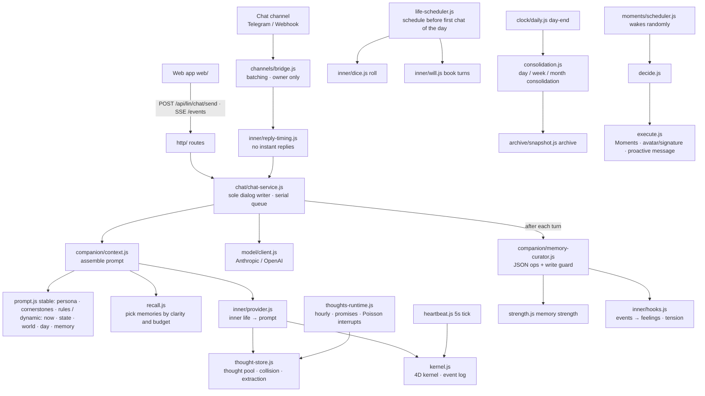

# Architecture and module map

> This document was cleaned from a private instance; all examples are fictional. For the authoritative module names and paths, see the `real-netizen/` tree.

## 1. What it is

Real Netizen is a **zero-dependency** Node.js service, plus a build-free single-page web app, plus optional chat-channel bots (Telegram / Webhook). You write a persona (`data/persona.md`) and what she knows about you (`data/core.md`), and she can chat with you in the browser or reach you through a channel you connected.

- One user, one computer. All data stays in `data/` on your machine; nothing is uploaded.
- Models speak standard OpenAI / Anthropic-compatible protocols; you supply the endpoint and key.
- Channels are optional: without one, it is a pure web chat.

## 2. Module map



## 3. Directory responsibilities

| Directory | Key points |
| --- | --- |
| `src/main.js` / `src/app.js` | Argument parsing, startup banner, exit on port conflict; `app.js` wires every module together (also used by HTTP tests) |
| `src/config/` | `paths.js` is the single source of all paths (incl. rollback scope `EXPERIENCE_PATHS`); `settings.js` field validation; `secrets.js` masking and "empty means keep"; `runtime.js` startup flags |
| `src/store/` | Atomic writes, mtime cache, serializer; conversations sharded by month as JSONL; `state.json` merged writes |
| `src/model/` | Request bodies and stream parsing for both protocols; reasoning-effort mapping with 400 fallback; background falls back to the chat model |
| `src/chat/` | `chat-service.js` is the sole dialog writer: web, channels, proactive messages, day-end, rollback — all go through the same queue |
| `src/companion/` | Persona and cornerstones, prompt, memory (read, recall, strength, consolidation, day-end), schedule, write guard |
| `src/inner/` | Legacy vitals and tension (`vitals.js`, `mapping.js`, `store.js`), no-instant-reply, dice, will, cornerstone (`core-self.js`); thought pool (`thoughts.js` pure functions, `thought-store.js` IO and model, `thought-context.js` export, `thoughts-runtime.js` background, `promises.js` timed commitments); 4D kernel (`body.js` equations, `body-drivers.js` input, `body-advance.js` advance, `kernel.js` events and checkpoints, `heartbeat.js` tick and mapping); `provider.js` assembles into the prompt by mode |
| `src/moments/` | Moments feed, avatar/signature, proactive messages; weather/news; image generation (`images.js`) |
| `src/channels/` | Channel contract (`types.js`), built-in channel registry (`registry.js`), bridge (`bridge.js`), Telegram long polling (`telegram/`), Webhook signature and callback (`webhook/`) |
| `src/archive/` + `src/clock/` | Archive, rollback, day-end clock |
| `src/http/` | Server, token, SSE, `routes/` endpoints |
| `web/js/` | `app.js` shell, `chat.js`, `moments.js`, `settings/` pages, `api.js` single transport |

## 4. Data files

All under `data/` (override with `--data`). See [data-and-migration.md](./data-and-migration.md) for the full migration story.

| File | Written by | Notes |
| --- | --- | --- |
| `settings.json` | Settings page | Non-secret settings; `canGetSick`, `sickMissCap` (sickness longing cap) under "Her days" |
| `persona.md` | Settings page | Persona; takes effect on the next message |
| `core.md` | Manual / settings | Cornerstone "about him" (what she knows about you) |
| `core-self.md` | Manual (optional) | Cornerstone "about herself"; overrides the built-in text when non-empty. She is herself first, independent of the user |
| `state.json` | Modules via `store/state.js` | Main conversation, last user message time, memory cursor, consolidation/archive progress, `restoring` |
| `conversations/<id>/YYYY-MM.jsonl` | chat-service only | Append-only |
| `memory/*.md`, `memory/life/*.md` | Memory curation, schedule generation, web | Through the write guard |
| `memory/.strength.json` | `companion/strength.js` | Memory strength |
| `media-library.json` | `companion/media-runtime.js` | Recommendation queue, source evidence, simulated consumption; participates in rollback |
| `moments.json`, `profile.json`, `media/` | `moments/store.js` | |
| `inner.json`, `inner-log.jsonl` | `inner/store.js`; the `body` subtree is written only by `inner/kernel.js` | Legacy vitals and causes; new kernel checkpoints |
| `kernel-log.jsonl` | `inner/kernel.js` only | New kernel events (seq, dedup, epoch); replayed on restart |
| `thoughts.jsonl`, `thoughts-state.json` | `inner/thought-store.js` only | Thought pool (last write wins per id) and `busy_until` |
| `pending-replies.json` | `inner/reply-timing.js` | Channel replies pending; survives restart; cleared on rollback |
| `archive/` | Archive / rollback | Content-addressed |
| `secrets/` | Settings page | `model.json`, `channels.json`, `access-token.txt`; endpoints return only masked values |
| `logs/` | `lin.ps1 -Watch` | `server.log`, `server.err.log` (previous `.prev.log`), `watchdog.log` |

## 5. Running and troubleshooting

```powershell
.\lin.ps1 -Restart                 # Restart after code changes (watchdog relaunches within 10s)
.\lin.ps1 -Open                    # Open the web app with the token
Get-Content data\logs\server.log -Tail 50
Get-Content data\logs\watchdog.log -Tail 20
node src/main.js --port 3031 --data <data-copy> --dry   # Rehearse on a copy: no channel messages, no background jobs
```

- Web **Settings → Advanced**: conversation id, data directory, her inner state (vitals, tension, defenses, current period, prompt to her, next pending reply).
- `GET /api/lin/inner`, `POST /api/lin/inner/simulate?hours=N[&memory=1]`, `POST /api/lin/inner/force {event}` (`sick` `overtime` `vacation` `healthy` `tension:book` `tension:seen` `stress` `tired` `drink`). Requires the token (`Authorization: Bearer <data/secrets/access-token.txt>`).
- No channel reply? Check `server.log` for `[lin:channels]`, `[lin:telegram]`, `[lin:webhook]`. A webhook `signature rejected` means the signature or timestamp is wrong; for Telegram first confirm the token and Chat ID with `getUpdates` (see [channels.md](./channels.md)).

## 6. Verification

- `node --test test/`: unit and API tests (fake models, fake channels). `test/privacy.test.js` checks that the old repo name and private words never appear and that no source file exceeds 400 lines.
- `test/dialogue-style.test.js` runs only static contracts by default; set `LIN_LIVE_STYLE_EVAL=1` to sample six scenarios against the configured model (`LIN_STYLE_CASE_FILTER` filters scenarios). It never writes real dialogs or sends channel messages; real phrasing still needs a human read.
- Rehearsal: export to a temp directory and start with `--dry`; see [data-and-migration.md](./data-and-migration.md).
- After changing the prompt, diff a real system prompt once to confirm she did not "become a different person".

## 7. Known pitfalls

- Windows PowerShell 5.1 + `ErrorActionPreference=Stop` treats child-process stderr as a terminating error; the watchdog uses `Start-Process -Redirect...`. `lin.ps1` must be UTF-8 **with BOM**, or Chinese text garbles.
- In the watchdog, wait with `WaitForExit(ms)`; do not "sleep the probe interval then look" — a crash would then take 30 seconds to relaunch.
- On Windows, `process.exit` while a server is still open prints a one-line libuv assertion; harmless.
- A channel reply is written to the dialog only when it is actually sent, so that turn's memory curation hangs on `bridge.onReplied`, not `afterTurn`.
- Her images (avatar, Moment photos, proactive photos) use the image model in settings (`images.js`), quality=low, ~20s. No web search for images: public search often returns hotlink-placeholder cards, and the program would think it changed the avatar while it actually stored a placeholder. If generation fails, she skips the avatar change and posts a text-only Moment; when `size` is not `auto`, `quality` must also be given or the gateway returns 500.
- `node --test test/` on Node 24 treats directories as modules; the entry point is `test/index.js`.
- For the "about him" memory layer, the base layer may borrow from the total budget surplus; do not revert to hard quotas (it would squeeze out the current-situation and errand layers).

## 8. Personality-stability rules (do not break)

- Answers use real system time; she does not play along if you change the time.
- The day's schedule is generated before the first chat of the day and then stays fixed; year/month/week layers only append, never overwrite.
- The past is immutable (write guard + HTTP 403), today is append-only, the future can change. Web and memory curation share the same rules (`companion/write-guard.js`).
- Deleting a message only hides it in the browser; recall is limited to 2 minutes; neither affects her memory.
- Her Moments are not a cron job: random intervals plus event triggers, doing nothing most of the time, with a daily cap and late-night silence.
- The model never sees numbers of her inner state, only one or two sentences. Safety exceptions (self-harm, suicidal keywords) take priority over everything: reply immediately, drop tiredness and defense hints.
- Two cornerstones go into the stable prompt section: "about him" in `data/core.md`; "about herself" defaults to code built-in and can be overridden by `data/core-self.md`. It is independent of the user, ensuring she is herself first; it is not recalled, not consolidated, never forgotten, never rolled back.
- Will conflicts follow Schopenhauer's original sense ([inner-kernel.md](./inner-kernel.md) §6.1): one will, two outlets; character turns impulse into words only; a blocked outlet yields its tension to an open one. "Being seen" never becomes a confession or an action.
- While awake, channel replies take at most 30 minutes (45 during sick/overtime weeks).

## 9. Not done / possible

- When the user sends several messages quickly they are batched into one turn after 2.5 seconds (`channels/bridge.js` `BATCH_WINDOW_MS`); occasionally she misreads them as one continuous remark.
- Images sent on a channel are rendered as "[He sent a picture]"; you can download and hand them to the model.
- A changed machine IP means manually updating the webhook callback address (or switch to Telegram long polling, which needs no public callback).
- The new kernel defaults to `shadow` (observe only). Watch "Settings → Advanced → Her inner state" curves for a few days before switching to `body` in settings; the two sets of numbers never drive replies at the same time. See [body-kernel.md](./body-kernel.md).
- The web app has no "past conversations" list (after starting a new conversation the old files remain in `data/conversations/`, just not visible).

## Glossary

| English | 中文 | Meaning |
| --- | --- | --- |
| Cornerstone memory | 基石记忆 | The two stable memories injected into every system prompt: "about him" and "about herself". |
| Thought pool | 念头池 | A pool of short-lived thoughts that collide, combine, and get extracted into the prompt. |
| Day-end settlement | 日结 | The nightly consolidation of memories, schedule, and archive. |
| Rollback | 回档 | Restore a past day's data and state from an archive snapshot. |
| Moments | 朋友圈 | Her social feed: posts, avatar/signature changes, proactive messages. |
| Write guard | 写入守卫 | Rules that keep the past immutable and today append-only. |
| Channel | 渠道 | An adapter that connects her to an external chat platform. |
| Bridge | 桥 | The module that batches inbound channel messages and delivers replies back to the same channel. |
| Reply timing | 回复时机 | The "don't reply instantly" scheduler that makes her feel alive. |
