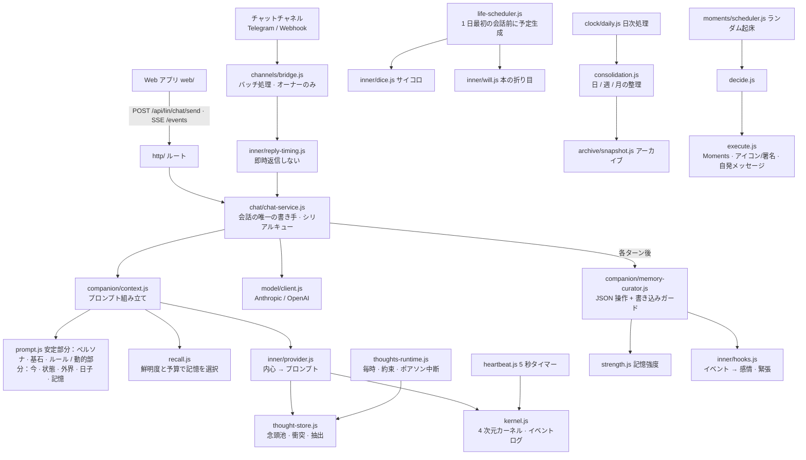

# アーキテクチャとモジュール図

> 本文書は個人利用版を浄化したもので、すべての例は架空です。正式なモジュール名とパスは `real-netizen/` ツリーを参照してください。

## 1. 概要

Real Netizen（リアル・ネティゼン）は、**依存パッケージゼロ**の Node.js サービス + ビルド不要のシングルページ Web アプリ + 任意のチャットチャネルボット（Telegram / Webhook）です。ペルソナ（`data/persona.md`）と、彼女があなたを知っていること（`data/core.md`）を書くだけで、ブラウザ上、または接続したチャネル上で会話できます。

- 1 ユーザー、1 台のパソコン。データはすべて `data/` に保存され、クラウドには何も送られません。
- モデルは標準的な OpenAI / Anthropic 互換プロトコルを使用。エンドポイントと Key は自分で入力。
- チャネルは任意。未接続の場合は純粋な Web チャットになります。

## 2. モジュール図



## 3. ディレクトリの責務

| ディレクトリ | ポイント |
| --- | --- |
| `src/main.js` / `src/app.js` | 引数解析、起動バナー、ポート競合時の終了；`app.js` が全モジュールを結線（HTTP テストでも使用） |
| `src/config/` | `paths.js` は全パスの唯一のソース（ロールバック範囲 `EXPERIENCE_PATHS` 含む）；`settings.js` フィールド検証；`secrets.js` マスキングと「空欄 = 維持」；`runtime.js` 起動フラグ |
| `src/store/` | アトミック書き込み、mtime キャッシュ、シリアライザ；会話は月別 JSONL；`state.json` は統合書き込み |
| `src/model/` | 両プロトコルのリクエストボディとストリーム解析；推論強度マッピングと 400 フォールバック；バックグラウンドはチャットモデルにフォールバック |
| `src/chat/` | `chat-service.js` が会話の唯一の書き手：Web、チャネル、自発メッセージ、日次処理、ロールバックすべてが同一キューを通過 |
| `src/companion/` | ペルソナと基石、プロンプト、記憶（読取、想起、強度、整理、日次）、予定、書き込みガード |
| `src/inner/` | 旧来のバイタル/緊張（`vitals.js`、`mapping.js`、`store.js`）、即時返信しない、ダイス、意志、基石（`core-self.js`）；念頭池（`thoughts.js` 純粋関数、`thought-store.js` 入出力とモデル、`thought-context.js` 出力、`thoughts-runtime.js` バックグラウンド、`promises.js` 時間約束）；4 次元カーネル（`body.js` 方程式、`body-drivers.js` 入力、`body-advance.js` 進行、`kernel.js` イベントとチェックポイント、`heartbeat.js` タイマーとマッピング）；`provider.js` がモードに応じてプロンプトに組み込む |
| `src/moments/` | Moments、アイコン/署名、自発メッセージ；天気/ニュース；画像生成（`images.js`） |
| `src/channels/` | チャネル契約（`types.js`）、組み込みチャネル登録（`registry.js`）、ブリッジ（`bridge.js`）、Telegram 長時間ポーリング（`telegram/`）、Webhook 署名とコールバック（`webhook/`） |
| `src/archive/` + `src/clock/` | アーカイブ、ロールバック、日次時計 |
| `src/http/` | サーバ、トークン、SSE、`routes/` 各種エンドポイント |
| `web/js/` | `app.js` シェル、`chat.js`、`moments.js`、`settings/` 各ページ、`api.js` 唯一の通信路 |

## 4. データファイル

すべて `data/` 以下（`--data` で変更可）。移行の詳細は [data-and-migration.md](./data-and-migration.md) を参照。

| ファイル | 書き手 | 備考 |
| --- | --- | --- |
| `settings.json` | 設定ページ | 非機密設定；`canGetSick`、`sickMissCap`（病気時の想い上限）は「彼女の日子」 |
| `persona.md` | 設定ページ | ペルソナ、次のメッセージから効く |
| `core.md` | 手動 / 設定 | 基石「彼について」（彼女があなたを知っていること） |
| `core-self.md` | 手動（任意） | 基石「彼女自身について」；非空のときに内蔵テキストを上書き。ユーザーとは独立し、彼女がまず彼女自身であることを保証 |
| `state.json` | 各モジュール（`store/state.js` 経由） | メイン会話、最終ユーザーメッセージ時刻、記憶カーソル、整理/アーカイブ進捗、`restoring` |
| `conversations/<id>/YYYY-MM.jsonl` | chat-service のみ | 追記のみ |
| `memory/*.md`、`memory/life/*.md` | 記憶整理、予定生成、Web | 書き込みガード経由 |
| `memory/.strength.json` | `companion/strength.js` | 記憶強度 |
| `media-library.json` | `companion/media-runtime.js` | 推薦キュー、出典証拠、模擬消費進捗；ロールバックに参加 |
| `moments.json`、`profile.json`、`media/` | `moments/store.js` | |
| `inner.json`、`inner-log.jsonl` | `inner/store.js`；`body` サブツリーは `inner/kernel.js` のみが書き込み | 旧来のバイタルと変化原因；新カーネルのチェックポイント |
| `kernel-log.jsonl` | `inner/kernel.js` のみ | 新カーネルのイベント（seq、重複排除、epoch）；再起動時に再生 |
| `thoughts.jsonl`、`thoughts-state.json` | `inner/thought-store.js` のみ | 念頭池（id ごとに後勝ち）と busy_until |
| `pending-replies.json` | `inner/reply-timing.js` | チャネルの未返信；再起動後も保持；ロールバックでクリア |
| `archive/` | アーカイブ / ロールバック | コンテンツアドレス |
| `secrets/` | 設定ページ | `model.json`、`channels.json`、`access-token.txt`；API はマスキング後の値のみ返却 |
| `logs/` | `lin.ps1 -Watch` | `server.log`、`server.err.log`（前回分 `.prev.log`）、`watchdog.log` |

## 5. 運用とトラブルシューティング

```powershell
.\lin.ps1 -Restart                 # コード変更後に再起動（監視が 10 秒以内に起動）
.\lin.ps1 -Open                    # トークン付きで Web アプリを開く
Get-Content data\logs\server.log -Tail 50
Get-Content data\logs\watchdog.log -Tail 20
node src/main.js --port 3031 --data <データコピー> --dry   # コピーでリハーサル：チャネル送信なし、バックグラウンドなし
```

- Web **設定 → 詳細**：会話 ID、データディレクトリ、彼女の内心（バイタル、緊張、防衛、現在の時段、彼女へのヒント、次の未返信）。
- `GET /api/lin/inner`、`POST /api/lin/inner/simulate?hours=N[&memory=1]`、`POST /api/lin/inner/force {event}`（`sick` `overtime` `vacation` `healthy` `tension:book` `tension:seen` `stress` `tired` `drink`）。トークン必要（`Authorization: Bearer <data/secrets/access-token.txt>`）。
- チャネルに返信がない：`server.log` の `[lin:channels]`、`[lin:telegram]`、`[lin:webhook]` を確認。webhook `signature rejected` は署名またはタイムスタンプの誤り。Telegram はまず `getUpdates` でトークンとチャット ID を確認（[channels.md](./channels.md) 参照）。

## 6. 検証手段

- `node --test test/`：ユニットと API テスト（偽モデル、偽チャネル）。`test/privacy.test.js` が旧リポジトリ名とプライバシー語の不出現、およびソース 400 行制限をチェック。
- `test/dialogue-style.test.js` はデフォルトで静的契約のみ；`LIN_LIVE_STYLE_EVAL=1` で設定モデルに対する 6 シナリオのサンプリング（`LIN_STYLE_CASE_FILTER` で絞込）。実際の会話やチャネル送信は行わず、実際の語感は人間の確認が必要。
- リハーサル：一時ディレクトリにエクスポートして `--dry` で起動。[data-and-migration.md](./data-and-migration.md) 参照。
- プロンプト変更後は、実際のシステムプロンプトを一度差分確認し、「別人になった」でないことを確かめる。

## 7. 既知の落とし穴

- Windows PowerShell 5.1 + `ErrorActionPreference=Stop` は子プロセス stderr を終了エラー扱いにする。監視では `Start-Process -Redirect...` を使用。`lin.ps1` は UTF-8 **BOM 付き**であること。なしでは日本語/中国語が文字化け。
- 監視での待機は `WaitForExit(ミリ秒)` を使い、「探活間隔だけ寝る」のは避ける。クラッシュ時に 30 秒も再起動が遅れる。
- Windows で `process.exit` 時に未クローズの server があると libuv アサーションが 1 行出るが無害。
- チャネル返信は実際に送信された時だけ会話に書き込まれる。そのターンの記憶整理は `afterTurn` ではなく `bridge.onReplied` に紐づく。
- 彼女の画像（アイコン、Moments 写真、自発写真）は設定の画像モデル（`images.js`）を使用、quality=low、約 20 秒。ウェブ検索画像は使わない：公開検索は盗链プレースホルダーを返しやすく、プログラムは成功と誤認する。生成失敗時はアイコン変更をスキップしてテキスト投稿。`size` が `auto` 以外のときは `quality` も必要、ないとゲートウェイが 500 を返す。
- Node 24 で `node --test test/` はディレクトリをモジュール扱いにする。エントリは `test/index.js`。
- 「彼について」記憶層：ベース層は総予算の余剰から借用可。ハードクオータに戻さない（現在の状況や用事の層を圧迫する）。

## 8. 人格安定性のルール（壊さない）

- 回答は実システム時刻に基づく。ユーザーが時刻を変更してもそれに流されない。
- 1 日の予定はその日の最初の会話前に生成され、以降は固定。年/月/週層は追記のみ、上書きしない。
- 過去は不変（書き込みガード + API 403）、今日は追記のみ、未来は可変。Web と記憶整理が同一ルール（`companion/write-guard.js`）。
- メッセージ削除はブラウザ上の非表示のみ；取り消しは 2 分制限；どちらも彼女の記憶に影響しない。
- 彼女の Moments は定期実行ではない：ランダム間隔 + イベントトリガー。ほとんどの時間は何もせず、日次上限と深夜沈黙がある。
- モデルには内心の数値を一切見せない。1、2 文のヒントのみ。安全例外（自傷、自殺キーワード）が最優先：即返信し、疲労/防衛ヒントを外す。
- 2 つの基石がプロンプトの安定部分に入る：「彼について」は `data/core.md`、「彼女自身について」はコード内蔵（`data/core-self.md` で上書き可）。ユーザーとは独立し、彼女がまず彼女自身であることを保証。想起されず、整理されず、忘却されず、ロールバックされない。
- 意志の衝突はショーペンハウアーの本義に従う（[inner-kernel.md](./inner-kernel.md) §6.1）：一つの意志、二つの出口。性格が衝動を言葉に変える。塞がれた出口の緊張は開いた出口へ譲渡される。「見られること」が告白や行動に変わることはない。
- 起動中、チャネル返信は最長 30 分（病気/残業週は 45 分）。

## 9. 未実装 / やりうること

- ユーザーが連続して送ったメッセージは 2.5 秒で 1 ターンにバッチ（`channels/bridge.js` の `BATCH_WINDOW_MS`）。時々、連続発言と誤認する。
- チャネルで受信した画像は「[彼が画像を送った]」と表示される。ダウンロードしてモデルに渡すと対応可能。
- PC の IP 変更時は Webhook コールバック先を手動変更（または Telegram の長時間ポーリングに切り替え、公网コールバック不要）。
- 新カーネルはデフォルト `shadow`（観察のみ）。「設定 → 詳細 → 彼女の内心」の曲線を数日見てから `body` へ切替。2 つの数値セットは同時に返信を制御しない。[body-kernel.md](./body-kernel.md) 参照。
- Web アプリには過去会話リストがない（新規会話後も旧ファイルは `data/conversations/` に残るが、見えない）。

## 用語集

| English | 日本語 | 意味 |
| --- | --- | --- |
| Cornerstone memory | 基石記憶 | システムプロンプトに常に入る 2 つの安定記憶：「彼について」と「彼女自身について」。 |
| Thought pool | 念頭池 | 短命な念頭が衝突・結合し、プロンプトに抽出されるプール。 |
| Day-end settlement | 日次処理（日結） | 夜間の記憶・予定・アーカイブ整理。 |
| Rollback | ロールバック | アーカイブスナップショットから過去の日のデータと状態を復元。 |
| Moments | 投稿（朋友圈） | アイコン/署名変更、投稿、自発メッセージなど、彼女側から発信するコンテンツ。 |
| Write guard | 書き込みガード | 過去を不変、今日を追記のみに保つルール。 |
| Channel | チャネル | 彼女を外部チャットプラットフォームに接続するアダプタ。 |
| Bridge | ブリッジ | 受信メッセージをバッチし、同じチャネルへ返信を届けるモジュール。 |
| Reply timing | 返信タイミング | 即時返信を避けて生命感を出すスケジューラ。 |
