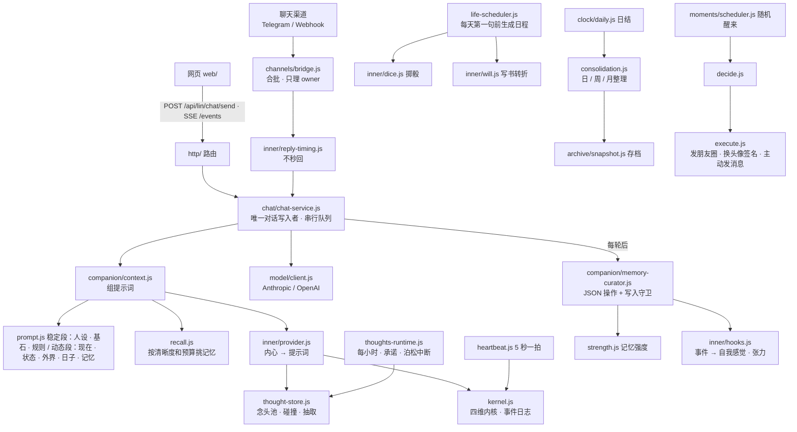

# 架构与模块地图

> 本文由私有版本清洗而来；示例均为虚构。实际模块名、路径以 `real-netizen/` 仓库为准。

## 1. 是什么

真实网友（Real Netizen）是一个**零第三方依赖**的 Node.js 服务，加上免构建的单页网页，以及可选的聊天渠道机器人（Telegram / Webhook）。你写好人设（`data/persona.md`）和她对用户的了解（`data/core.md`），她就能在网页里陪你聊天，也可以通过你接好的渠道主动找你。

- 一个用户、一台电脑。数据全在本地 `data/`，不上传任何云。
- 模型走标准 OpenAI / Anthropic 兼容协议，地址和 Key 自己填。
- 渠道可接可不接，不接时就是纯网页聊天。

## 2. 模块地图



## 3. 目录职责

| 目录 | 要点 |
| --- | --- |
| `src/main.js` / `src/app.js` | 参数解析、启动横幅、端口占用报错退出；`app.js` 把所有模块接起来（http 测试也用它） |
| `src/config/` | `paths.js` 是所有路径的唯一来源（含回档范围 `EXPERIENCE_PATHS`）；`settings.js` 字段校验；`secrets.js` 打码与「留空不改」；`runtime.js` 启动参数 |
| `src/store/` | 原子写、mtime 缓存、串行器；对话按月分片 JSONL；`state.json` 统一合并写 |
| `src/model/` | 两种协议的请求体与流解析；推理强度映射与 400 回退；后台失败退回聊天模型 |
| `src/chat/` | `chat-service.js` 是对话唯一写入者：网页、渠道、主动消息、日结、回档全走同一条队列 |
| `src/companion/` | 人设与基石、提示词、记忆（读、召回、强度、整理、日结）、日程、写入守卫 |
| `src/inner/` | 旧版体征与张力（`vitals.js`、`mapping.js`、`store.js`）、不秒回、掷骰、意志、基石（`core-self.js`）；念头池（`thoughts.js` 纯函数、`thought-store.js` 读写与模型、`thought-context.js` 出口、`thoughts-runtime.js` 后台、`promises.js` 时间承诺）；四维内核（`body.js` 方程、`body-drivers.js` 输入、`body-advance.js` 推进、`kernel.js` 事件与检查点、`heartbeat.js` 心跳与映射）；`provider.js` 按模式拼进提示词 |
| `src/moments/` | 朋友圈、头像签名、主动消息；天气新闻；生图（`images.js`） |
| `src/channels/` | 渠道契约（`types.js`）、内置渠道表（`registry.js`）、合批桥（`bridge.js`）、Telegram 长轮询（`telegram/`）、Webhook 签名与回调（`webhook/`） |
| `src/archive/` + `src/clock/` | 存档、回档、日结时钟 |
| `src/http/` | 服务器、令牌、SSE、`routes/` 各接口 |
| `web/js/` | `app.js` 外壳、`chat.js` 聊天、`moments.js` 朋友圈、`settings/` 各设置页、`api.js` 唯一通道 |

## 4. 数据文件

都在 `data/`（`--data` 可改）。完整迁移说明见 [`data-and-migration.md`](./data-and-migration.md)。

| 文件 | 谁写 | 备注 |
| --- | --- | --- |
| `settings.json` | 设置页 | 非敏感设置；`canGetSick`、`sickMissCap`（生病时想念上限）在「她的日子」 |
| `persona.md` | 设置页 | 人设，下一句生效 |
| `core.md` | 手改 / 设置页 | 基石「关于他」（她对用户的了解） |
| `core-self.md` | 手改（可选） | 基石「关于她自己」；存在且非空时覆盖内置文本。默认她只是她自己，与用户无关 |
| `state.json` | 各模块经 `store/state.js` | 主对话、最后一次他说话、记忆游标、整理 / 存档进度、`restoring` |
| `conversations/<id>/YYYY-MM.jsonl` | 只有 chat-service | 只追加 |
| `memory/*.md`、`memory/life/*.md` | 记忆整理、日程生成、网页 | 经写入守卫 |
| `memory/.strength.json` | `companion/strength.js` | 记忆强度 |
| `media-library.json` | `companion/media-runtime.js` | 推荐队列、来源证据、模拟消费进度；参与回档 |
| `moments.json`、`profile.json`、`media/` | `moments/store.js` | |
| `inner.json`、`inner-log.jsonl` | `inner/store.js`；`body` 子树只由 `inner/kernel.js` 写 | 旧版体征与变化原因；新内核的检查点 |
| `kernel-log.jsonl` | 只有 `inner/kernel.js` | 新内核的事件（seq、去重、epoch），重启时重放 |
| `thoughts.jsonl`、`thoughts-state.json` | 只有 `inner/thought-store.js` | 念头池（同 id 后写覆盖）与 busy_until |
| `pending-replies.json` | `inner/reply-timing.js` | 渠道待回复，重启后继续，回档清空 |
| `archive/` | 存档 / 回档 | 内容寻址 |
| `secrets/` | 设置页 | `model.json`、`channels.json`、`access-token.txt`；接口只返回打码版本 |
| `logs/` | `lin.ps1 -Watch` | `server.log`、`server.err.log`（上一份 `.prev.log`）、`watchdog.log` |

## 5. 运行与排查

```powershell
.\lin.ps1 -Restart                 # 改完代码后重启（守护 10 秒内拉起）
.\lin.ps1 -Open                    # 带令牌打开网页
Get-Content data\logs\server.log -Tail 50
Get-Content data\logs\watchdog.log -Tail 20
node src/main.js --port 3031 --data <数据副本> --dry   # 用副本试：不发渠道消息、不跑后台
```

- 网页「设置 → 高级」：对话 ID、数据目录、她的内心（体征、张力、防线、当前时段、给她的提示、下一条待回复）。
- `GET /api/lin/inner`、`POST /api/lin/inner/simulate?hours=N[&memory=1]`、`POST /api/lin/inner/force {event}`（`sick` `overtime` `vacation` `healthy` `tension:book` `tension:seen` `stress` `tired` `drink`）。调用要带令牌（`Authorization: Bearer <data/secrets/access-token.txt>`）。
- 渠道没反应：看 `server.log` 里 `[lin:channels]`、`[lin:telegram]`、`[lin:webhook]`；webhook 的 `signature rejected` 是签名或时间戳不对；Telegram 机器人先用 `@BotFather` 的 `/token` 和 Chat ID 确认（见 [`channels.md`](./channels.md)）。

## 6. 验证手段

- `node --test test/`：单元与接口测试（假模型、假渠道）。`test/privacy.test.js` 检查不出现旧仓库名与隐私词、单文件不超过 400 行。
- `test/dialogue-style.test.js` 默认只跑静态契约；设 `LIN_LIVE_STYLE_EVAL=1` 可对当前配置模型做六类场景采样（`LIN_STYLE_CASE_FILTER` 筛场景）。不会写真实对话或发渠道消息，真实语感仍需人工读。
- 演练：导出到临时目录后 `--dry` 启动，见 [`data-and-migration.md`](./data-and-migration.md) 的演练记录。
- 改提示词后，对比一次实际请求的系统提示词，确认她没「变了个人」。

## 7. 已知坑

- Windows PowerShell 5.1 + `ErrorActionPreference=Stop` 会把子进程 stderr 当终止错误：守护里用 `Start-Process -Redirect...`。`lin.ps1` 必须是 UTF-8 带 BOM，否则中文乱码。
- 守护里等进程用 `WaitForExit(毫秒)`，别用「睡满探活间隔再看」，否则崩了要等 30 秒才拉起。
- Windows 下 `process.exit` 时还有没关的 server 会打印一行 libuv 断言，无害。
- 渠道回复只有真正发出时才写进对话，所以那一轮的记忆整理挂在 `bridge.onReplied` 上，不在 `afterTurn` 里。
- 她的图（头像、朋友圈配图、主动发的照片）用设置里的生图模型生成（`images.js`），quality=low、约 20 秒。不再联网搜图：公开搜索常返回防盗链占位图，程序以为换成功了，实际是一张占位卡片。生不出图就不换头像、朋友圈改发纯文字；`size` 不是 `auto` 时必须同时给 `quality`，否则网关返回 500。
- `node --test test/` 在 Node 24 会把目录当模块，入口是 `test/index.js`。
- 记忆召回的「关于他」层：底色层可以借用总预算余量；不要再改回硬配额（会把近况、事务等其他记忆层挤掉）。

## 8. 人格稳定性的规矩（别破坏）

- 回答以真实系统时间为准，不顺着他改时间。
- 每天第一次聊天前生成当天日程，生成后当天不变；年 / 月 / 周只补不覆盖。
- 过去不可改（写入守卫 + 接口 403），今天只追加，未来可变。网页和记忆整理用同一套规则（`companion/write-guard.js`）。
- 删除消息只是浏览器本地隐藏，撤回限 2 分钟；都不影响她的记忆。
- 她的动态不是定时任务：随机间隔 + 事件触发，大多数时候什么都不做，有每日上限和深夜静默。
- 模型永远看不到内心状态的数字，只看到一两句话。安全例外（自伤、轻生关键词）优先于一切：立即回、去掉疲惫和防线类提示。
- 两条基石进系统提示词稳定段：「关于他」在 `data/core.md`；「关于她自己」默认内置在 `src/inner/core-self.js`，可由 `data/core-self.md` 覆盖。它和用户无关，保证她首先是她自己；不进记忆召回、不参与整理、不遗忘、不回档。
- 意志冲突按叔本华本义（[`inner-kernel.md`](./inner-kernel.md) 第 6.1 节）：一个意志两个出口；性格决定冲动只能变成言语；堵住的出口把张力让给开着的出口。「被看见」永远不会变成表白或行动。
- 醒着时渠道回复最晚 30 分钟（生病 / 加班周 45 分钟）。

## 9. 还没做 / 可以做

- 用户连发几条时攒 2.5 秒合成一轮（`channels/bridge.js` 的 `BATCH_WINDOW_MS`），偶尔会误解成串话。
- 渠道发来的图片只转成「[他发了一张图片]」，可以下载后交给模型看。
- 电脑 IP 变动要手动改 Webhook 回调地址（或改用 Telegram 长轮询，不用公网回调）。
- 新内核默认 `shadow`（只观察）。先看几天「高级 → 她的内心」的曲线，再在设置里切到 `body`；两套数值不会同时控制回复。细节见 [`body-kernel.md`](./body-kernel.md)。
- 网页没有「以前的对话」列表（开始新对话后旧对话文件还在 `data/conversations/`，只是看不到）。
