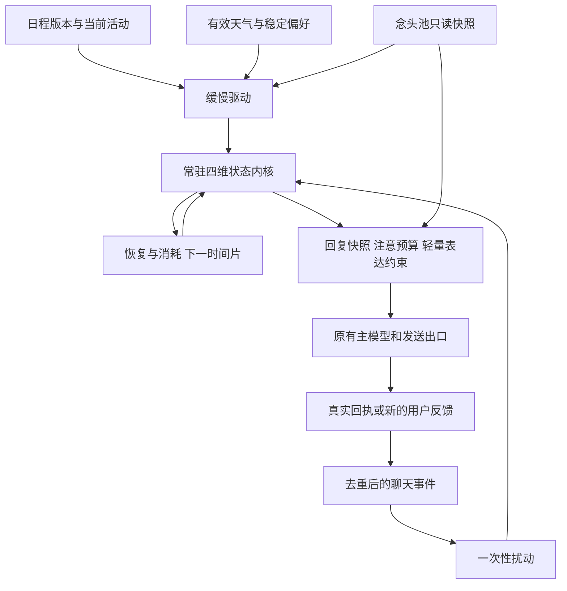

> 本文由私有版本清洗而来；示例均为虚构。

# 持续情绪与身体式内核：施工规格

> 状态：**已施工（2026-10-10），默认 `shadow` 模式**：新内核常驻运行、记录事件，但还不控制回复。实现与偏差见文末「施工记录」。
> 承接：`thought-pool.md`。念头池管“心里有什么事”，身体内核管“带着怎样的持续状态经历这些事”。
> 核心决定：保留一个真正随服务常驻的小程序。无人聊天时照常更新；日程、天气、念头和聊天事件改变它；回复只是读取它的一个截面。
> 边界：这是具有因果连续性的角色状态模拟，不宣称产生意识、生理体验或真实心跳。所有权重都是工程初值，不是医学或心理学定律。

---

## 0 本版直接拍板的事项

1. **持续运行**：默认每 5 秒推进一次；聊天窗口关闭不停止，只有服务停止、系统休眠或明确暂停时停止。
2. **小内核**：只有四个独立状态——愉悦度、激活度、精力、张力。模拟心率是派生读数，不再增加一个独立情绪控制器。
3. **纯代码心跳**：每次推进只做算术、处理已经入队的事件，不调用模型、不联网、不生成内心独白。
4. **时间连续**：恢复按实际经过的时间计算，不能写成“每次 tick 减 1”。重启不重置，每天第一句话不重抽心情。
5. **双向但有边界**：念头影响张力和注意；身体状态影响可投入的注意预算。禁止“心情不好 → 所有坏念头变强 → 心情更坏”的无条件自激。
6. **一个权威状态源**：正式切换后，12 号旧数值系统与 14 号系统不能同时控制回复、精力和延迟。
7. **不靠用户来维持稳定**：普通沉默不是拒绝，用户不回复不自动累计怨气；不以讨好、愧疚或强迫陪伴作为恢复机制。

本版不做情绪类别大全、激素模拟、随机心情抽签，也不修改长期人设。

## 1 与 13 和现有源码的关系

### 1.1 13 的内容保留什么

- 保留 15 条念头的容量、来源、可说性、回避标记、相关度碰撞和长期记忆边界。
- 念头仍然描述具体事情，而不是“悲伤值 70”这样的情绪标签。
- 日程、聊天、主动消息、朋友圈继续使用原有出口，不再造一套发送系统。
- 身体状态没有“对他的态度”“爱意”“想念”三个额外数值。关系判断仍要落在具体经历上。

### 1.2 本文明确补充或收紧的规则

| 13 的原思路 | 接入 14 时的执行口径 |
|---|---|
| 所有感觉都由念头池产生，不另做变量 | 增加四个跨事件的连续状态；念头回答原因，状态保存惯性。两者不互相替代。 |
| 念头 tick 每小时一次 | 保留独立的小时级念头更新。绝不能把每小时的 `+1/-2` 搬到每 5 秒执行。 |
| 未闭合念头每小时 `+1` | 不能普遍解释为持续受伤。接入本版时，只有有明确期限的事项才允许随临近升高；无期限等待不因沉默自动加压。 |
| 回避命中后强度增加 | 一次已去重的消息最多影响一次，不得每次读取快照都增加。用户明确纠正事实时，应修正推断。 |
| 溢出路由后强度减 30 | **候选入队不等于说出口**。只在对应出口确认成功后减一次；取消、失败和结果未知都不释放。同一念头已有待处理候选时不再重复入队。 |
| 不可说念头把 20% 分给其他念头 | 首版不启用。若以后启用，必须从来源扣除同等总量，接收方达到上限的部分丢弃，禁止复制强度。 |
| 允许漏半句 | 不因高张力自动授权泄露不可说内容；14 不扩大披露权限。 |

这些是本文集成路径的施工约束，不回写或悄悄修改 13 的原文。

13 §9 的回复时限有尚需统一的分支；14 不借机重做它。首版保留当前 `reply-timing.js` 的时间上限与安全例外，情绪不另加一套惩罚性等待。

### 1.3 本次只读核对到的真实接点

以下路径均相对 `Lin/`，是写本文时的源码位置，不是对运行状态的保证。

| 位置 | 当前已有 | 本版改动方向 |
|---|---|---|
| `src/inner/vitals.js:129` | `settle` 按日程、时间补算旧体征 | 不把它和新方程叠加；用模式开关选择权威内核。 |
| `src/inner/store.js:61` | 串行 `settleNow`、事件写入、原子快照 | 继续作为唯一写入口，增加内存状态、事件去重、低频检查点。 |
| `src/inner/tags.js:62` | 标签日程解析，支持“实际：”覆盖 | 复用解析结果，规范化为本版的活动驱动。 |
| `src/companion/life-scheduler.js:40` | 首次聊天补齐日程，常驻时零点后 2 分钟预生成 | 两个入口统一产出日程版本事件，不再新建第二个每日生成器。 |
| `src/moments/world.js:75` | 天气缓存，过期刷新，失败时保留旧天气 | 增加真正的天气观测时间，避免旧天气被伪装成刚更新。 |
| `src/companion/context.js:37`、`src/inner/state.js:38` | `innerProvider` 注入主模型动态提示词 | 替换为同一份念头与身体快照。 |
| `src/chat/chat-service.js:73`、`src/chat/chat-service.js:155` | Web / 渠道用户消息写入后的共同钩子 | 用落盘的消息 ID 建立事件，不按模型调用次数计数。 |
| `src/chat/chat-service.js:109`、`src/channels/bridge.js` | 生成后回调与实际发送不是同一时刻 | 情绪输入、生成成功、发送成功分开，见 §9。 |
| `src/config/paths.js:63` | `inner.json` 和 `inner-log.jsonl` 已在经历回档范围 | 复用这两个文件，不额外建立另一套身体数据目录。 |

**当前快照的接线前提**：`package.json` 声明入口为 `src/main.js`，但本次读取该路径时文件不存在；在 `src/` 中也未检索到 13 的 `thoughts.jsonl` / `collide` 实现。施工前先确认实际启动入口与 13 的落地进度，不能据文档假定它们已运行。本文不修复入口，也不声称整个应用已可启动。

## 2 最小结构：一个循环，两类输入



必须区分：

- **驱动**改变趋近的背景或变化速率：工作负荷、休息、天气、未完成事项。驱动存在多久，就作用多久，不每次刷新重新加分。
- **扰动**是某个事件发生时的一次冲击：被具体理解、预期落空、误会澄清。同一事件只能施加一次。

“今天下雨”是持续背景，不是每 5 秒再次发生的坏事；“刚收到一条消息”是事件，但收到消息本身不等于被安慰。

## 3 状态、单位与存储契约

### 3.1 四个独立状态

| 字段 | 符号 | 范围 | 首次初值 | 含义 |
|---|---|---|---|---|
| `valence` | V | −100～100 | 8 | 愉悦／不快的持续底色，不等于喜欢／讨厌用户。 |
| `activation` | A | 0～100 | 25 | 平静到兴奋／警觉。同样的高激活可能对应期待，也可能对应紧张。 |
| `energy` | E | 0～100 | 70 | 可投入的资源预算，不是模型算力，也不声称真实疲劳。 |
| `tension` | T | 0～100 | 10 | 未释放的负荷与牵引，不把一切未完成事项都视为痛苦。 |

统一约定：持久化时间用 Unix 毫秒；公式时间用分钟，精力速率用“点／小时”；内部保留浮点数，只在展示时取整。

参数集中在一个版本化常量对象中。模型不能返回新系数，不能每天随机改初值。

### 3.2 复用 `inner.json`，增加 `body` 子树

以下是新增子树示意，不是整个文件的替换内容；保留迁移所需的旧字段。

```json
{
  "body": {
    "schemaVersion": 1,
    "paramsVersion": "body-v1",
    "at": 1791637200000,
    "values": { "valence": 8, "activation": 25, "energy": 70, "tension": 10 },
    "segment": {
      "until": 1791637205000,
      "targets": { "valence": 8, "activation": 21.1, "tension": 10 },
      "energyRatePerHour": -1
    },
    "lastEventSeq": 0,
    "epoch": 1,
    "inputVersions": { "schedule": 0, "weather": 0, "thoughts": 0 },
    "dedup": [],
    "impulseWindow": [],
    "bands": { "lowEnergy": false, "highActivation": false, "highTension": false, "valence": "neutral" }
  }
}
```

还需在同一检查点保存以下数据，不能只保存四个数：

| 数据 | 必须包含 |
|---|---|
| 当前输入快照 | 已采用的日程段、采用时间、版本；天气观测时间和城市；念头 ID、强度、负荷系数。 |
| `dedup` | 已接受事件的稳定 ID、规范化载荷摘要、接受时间；保留 7 天。 |
| 感知登记 | 消息 ID、第一次实际处理它的 `perceivedAt`、所属 epoch；重试不能刷新这个时间。 |
| `impulseWindow` | 最近 10 分钟实际施加的扰动及接受时间，用于预算限幅。 |
| `segment` | 当前时间小段的目标与速率；不足一格的补算后不能丢掉它。 |
| `epoch` | 回档／重建时递增，用来丢弃旧世界里的异步结果。 |

`bands` 只是带滞回的表现档位，不是第五种情绪。它在推进或接受事件后更新；读取时只能投影副本，不能修改权威档位。`inputVersions` 标识因果来源，不能代替输入内容。

### 3.3 念头只增加一个可选的负荷描述

在 13 的念头对象中允许增加：

```json
{
  "affect": {
    "demand": 0.6,
    "evidenceEventId": "chat:msg_042:appraisal-v1"
  }
}
```

- `demand` 范围 0～1，表示此事有多少待处理负荷；缺失时为 0，不从“不可说”自动推定负荷。
- 只有明确事件或经校验的抽取结果能修改它。每次 tick 不能让它自增。
- 对未来的愉快期待可以有高 `strength`、低 `demand`，不必被算成焦虑。
- 念头闭合后退出持续负荷计算；过去形成的 T 按时间恢复，不瞬间清空。
- 13 未施工时，适配器返回空池、版本 0；日程和聊天部分仍可独立工作。

## 4 输入怎么变成可计算的驱动

### 4.1 日程：生成是建立预期，不是宣布一切已经发生

复用现有 `ensureLife` 与日程文件，每天只生成一份；日程有修改时增加版本。

每段规范化为：`slotId、startAt、endAt、tag、load、recovery、physical、interest、provenance`。

- L = `load`，R = `recovery`，P = `physical`，范围均为 0～1。
- I = `interest`，范围 −1～1，来自稳定偏好，首版默认全部为 0，不让日程生成模型随意赋值。
- `provenance` 为 `simulation_plan`、`simulation_update` 或 `fallback`。角色的生活模拟不能写成用户真实生活的证据。
- 时区沿用项目本地时区，部署时固定；跨日不重置身体状态。更换时区属于显式配置操作，不默默重解释历史。

首版标签表如下；数字是待校准的工程默认值：

| 标签 | L | R | P | 说明 |
|---|---:|---:|---:|---|
| 起床、空闲 | 0 | 0.2 | 0 | 普通清醒，不自动视为深度休息。 |
| 睡觉 | 0 | 0 | 0 | 走专门睡眠公式，忽略本行 R。 |
| 吃饭 | 0 | 0.6 | 0 | 休息背景，不额外重复加“开心”。 |
| 上班、写作 | 0.65 | 0 | 0 | 认知负荷。 |
| 加班、截止 | 0.9 | 0 | 0 | 更高负荷，不在段首再叠加旧版压力冲击。 |
| 开会 | 0.75 | 0 | 0 | 忙闲由原有回复调度处理。 |
| 运动 | 0.3 | 0 | 0.85 | 生理模拟激活可升高，不等于烦躁。 |
| 通勤、出门 | 0.25 | 0 | 0.25 | 弱负荷。 |
| 洗澡 | 0 | 0.5 | 0.1 | 恢复背景。 |
| 天文台 | 0.35 | 0.1 | 0.1 | 喜爱程度另由 I 表达。 |
| 喝酒、生病 | 0 | 0.5 | 0 | 首版仅保守处理为休息，不新增酒精／疾病机制或诊断。 |

实际执行规则：

1. 日程生成时只登记未来驱动，不一次性结算全日工作量。
2. 服务推进到某一段时，采用该段驱动。这是沿计划执行的角色生活模拟，不自动证明“工作完成”“读完一本书”。
3. “实际：”或明确修改只从采用时刻往后生效。`effectiveAt = max(声明时刻, 采用时刻)`；不重写已经历过的时间。
4. 首次聊天到中午才生成日程：此前按兜底段推进，新计划只从现在采用，不能把刚生成的“早晨争执”倒灌进心情。
5. 没日程时复用 `fallbackSlots()` 的睡眠／清醒时段，不让整个晚上永远维持“上班”。
6. 同一 `slotId` 的自然进入只产生一次边界事件。版本更新不重复触发已经执行的段首效果。

日程文本不给身体计算函数；只给数值和 ID。计划内容也不因为身体需要它，就整段重新灌进每轮聊天。

### 4.2 未来一小时的预期负荷 F

对未来 60 分钟内尚未开始的日程段：

$$
F=\max_i\left[L_i\left(1-\frac{\text{距开始分钟数}_i}{60}\right)\right]
$$

没有候选时 F = 0，范围夹到 0～1。只取最大值，不把十项安排相加成十倍焦虑。它代表渐近的准备压力，不是已经经历了这些事。

### 4.3 天气 W：弱背景，有观测时间

- 稳定配置为不同 `weatherKind` 设置 −4～4 点偏好，默认都是 0。不能默认“阴天必然难过”。
- 有效背景为 `W = preference[kind] × freshness`，因此天气独立贡献始终不超过 4 点 V 目标。
- `freshness`：观测后 30 分钟内为 1，随后线性下降，到 6 小时为 0。缺失、非法数据、城市不匹配时为 0。
- 刷新周期复用 30 分钟缓存；有独立后台刷新任务，关闭朋友圈也不能停掉天气输入。
- 刷新不在心跳临界区进行。失败保留旧观测，继续按真实年龄褪色，不触发“失落”事件。

**必须补的现有字段**：当前 `getWorld` 失败保留旧天气时仍更新 `fetchedAt`。新增 `weatherObservedAt`，只有拿到新的有效天气才更新；旧缓存没有该字段时按未知处理，不能直接拿 `fetchedAt` 冒充。

不接入新闻情绪，不让外部天气文本成为提示词指令，也不拿此刻天气填补离线期间的历史天气。

### 4.4 念头负荷 U：有上限的持续牵引

取未闭合、`demand > 0` 的念头，计算 `strength / 100 × demand`，只取最大的三项：

$$
U=\operatorname{clamp}\left(\frac{\sum\operatorname{top3}(\text{strength}/100\times\text{demand})}{2},0,1\right)
$$

空池 U = 0。此值作为背景目标的输入，不是每次 tick 给 T 加一遍。低能量、高 T 不反向改写所有念头的强度。

## 5 连续更新方程：首版可直接实现

### 5.1 目标与精力速率

所有右侧都使用**当前小段开始时的同一份状态**计算，不能更新一个数后立即拿新值算另一个数。

令：

$$
D=\operatorname{clamp}\left(\frac{40-E}{40},0,1\right)
$$

清醒时：

$$
T^*=10+25L+18U+8F+8D
$$

$$
A^*=22+28L+32P+10F+0.15T-8(1-E/100)
$$

$$
\dot E=5R-2-4L-4P-2\max(0,(A-50)/50)
$$

睡眠模拟时：

$$
T^*=6+6U,\qquad A^*=8+0.10T,\qquad \dot E=12(1-0.4A/100)
$$

两种情况下的愉悦目标均为：

$$
V^*=8+W+5I-0.25\max(0,T-15)-0.10\max(0,40-E)
$$

目标按各自合法范围夹取。公式含义：负荷与未完成事项影响张力；张力影响激活；高激活增加消耗；低精力削弱投入，并稍微增加负荷感。恢复项持续与它们对抗。

没有“T 高就要求用户安慰”“用户来了精力直接加满”的路径。

### 5.2 褪色：按半衰期向当前目标靠近

对于 V、A、T：

$$
x'=x^*+(x-x^*)\,2^{-\Delta t/h_x}
$$

对于 E：

$$
E'=\operatorname{clamp}(E+\dot E\,\Delta t/60,0,100)
$$

其中 $\Delta t$ 为分钟，默认半衰期：

| 维度 | 半衰期 |
|---|---:|
| V 愉悦余韵 | 90 分钟 |
| A 激活／惊讶 | 8 分钟 |
| T 张力 | 60 分钟 |
| E 精力 | 无半衰期，按活动恢复／消耗 |

半衰期意味着“相对固定目标的差值减半”，不是“每 90 分钟愉悦值减半”。目标随处境变化时，整条曲线不再是单一指数。

先固定这组时间尺度；首版不为每种情绪单独造一套曲线。长期残留由未闭合事项维持目标，短期冲击由事件改变当前值。

### 5.3 模拟心率 H：派生，不反向控制

$$
H=\operatorname{round}\left(\operatorname{clamp}(58+0.35A+0.10T+35P-6\mathbf{1}_{睡眠},48,130)\right)
$$

- 单位标成“模拟 bpm”，仅供调试或可选角色表现，不是生理测量。
- 首版不把 H 再塞回 A/T 方程；否则会无意做出“心跳快 → 更紧张 → 心跳更快”的额外放大器。
- 不每次跳动抽随机数，不依据 H 诊断情绪，不生成“我真的心悸”等事实性声明。
- 软件 tick 是更新节拍，H 是模拟结果；两者不是同一个频率，也无须一致。

## 6 聊天怎样影响数值

### 6.1 分类模型只给评价，不给最终状态

沿用 13 的小模型通道。`collide` 已有前置相关度调用时，在**同一次调用**里附带评价；聊天后的抽取处理新念头和闭合。不再为身体系统增加第三次常规模型调用。

一条用户消息的评价结果：

```json
{
  "valence": 0.8,
  "activation": 0.3,
  "tension": -0.4,
  "importance": 0.7,
  "surprise": 0.2,
  "confidence": 0.9,
  "evidenceMessageIds": ["msg_042"],
  "relatedThoughtIds": ["t_017"]
}
```

字段契约：

- 前三个值为 −1～1 的方向和程度：愉悦／不快，激活／平静，增加张力／释然。
- 后三个数为 0～1。`confidence < 0.6` 或 `importance < 0.15` 时不施加数值冲击。
- 证据 ID 必须来自本次提供的已落盘消息；关联念头必须存在。证据不足允许返回 `null`。
- 验证对象形状、有限数值和范围。非法 JSON、NaN、字符串冒充数字、未知 ID 都拒绝；不能依靠夹取把非法输出洗成有效情绪。
- 禁止把用户普通离线、未回复、否定 Lin 的错误理解，自动判成羞辱或抛弃。
- 助手自己写出的“我很开心”不是外部事件证据，不允许据此再次给自己加分。

前置等待预算最多沿用 13 的 800ms；这会增加至多相应等待，不宣称零延迟。超时立刻用现有状态回复；晚到结果走同一去重入口，只影响后续。13 未实现时，先用手工事件完成纯内核，不为了演示伪造分类器。

### 6.2 确定的加权规则

$$
q=\operatorname{clamp}(\text{importance}\times\text{confidence}\times(0.5+0.5\text{surprise}),0,1)
$$

$$
\Delta V=18qv,\qquad\Delta A=22qa,\qquad\Delta T=18qt,\qquad\Delta E=0
$$

`v/a/t` 是评价里的三个方向值。旧状态影响事件的**后续演化**，首版不额外做“越难过越相信负面解释”的感知偏置。

施加前增加两个限幅：

1. 最近 10 分钟聊天扰动的**绝对值累计预算**分别为 V=24、A=30、T=24。
2. 本次事件按三个维度剩余预算的最小可用比例整体缩放，避免只截一半导致情绪方向失真；再把最终状态夹到合法范围。

对非零维度计算 `max(0, remaining) / abs(delta)`，取与 1 的最小值作为统一比例；全部为零时比例取 1，结果仍为零。预算记录按缩放后的扰动计，哪怕状态已经碰到边界也记入，不能通过顶满数值绕过限额。10 分钟窗口按时间滑动，不在整点突然刷新。

这使一句真正重要的话有作用，但不能靠连续刷夸奖、反复重试把数值推满。

### 6.3 去重、晚到与重复生成

事件 ID 由程序产生，不交给模型：

- 用户评价：`chat:<持久化消息ID>:appraisal-v1`。
- 日程采用：`schedule:<日期>:<版本>`。
- 天气观测：`weather:<城市>:<观测时间>`。
- 发送回执：`delivery:<稳定回复ID>`。

重试使用同一 ID。同一 ID、相同载荷为幂等重放；同一 ID、不同载荷返回冲突并保留首次结果，不双重施加。载荷摘要只覆盖业务内容，不包含每次重试都会变化的接受时间或顺序号。

区分消息发送时间、`perceivedAt`、`acceptedAt` 和顺序号 `seq`。聊天评价的 `occurredAt` 取第一次实际感知时的 `perceivedAt`，不是收件时间：睡眠中收到、醒来才读到的消息，冲击从醒来时开始，不因在队列里放了八小时而被褪掉。第一次开始感知时先持久化登记，重试不能重新计时。

正常事件先推进到接受时刻，再施加；时钟异常时逻辑接受时刻至少为当前状态时间，不允许负时长。后台结果晚到不倒写已经发出的回复：

- 从 `perceivedAt` 算起，评价晚到不超过 30 分钟：先对各维度冲击按其半衰期折减，再进入预算与去重。这是明确的近似，不是假装重新经历历史。
- 超过 30 分钟：可补记念头／记忆，不再制造一次突然的情绪尖峰。
- 自动补交入口拒收超过 7 天的事件，防止去重记录清理后旧事件重放；旧聊天重新回顾必须由**新的当下消息**构成新事件。
- 参数版本或回档 `epoch` 不匹配的异步结果直接丢弃。

用户原话已经被感知的影响，不因随后模型生成失败而撤销；但重试这轮回复不能再冲击一次。

有效的 `null` 评价登记为一次已处理的零冲击，避免反复抽取直到抽出情绪；解析失败则标记失败，可在时效内补交，二者不能混为一谈。

## 7 常驻时间机制

### 7.1 真正运行，不依赖聊天或朋友圈

拟新增 `createHeartbeat({ now, setTimer, clearTimer, kernel })`，提供 `start / pause / resume / stop`。

- 由实际服务入口在存储恢复后启动，幂等启动；关闭网页、渠道不在线、朋友圈禁用都不影响它。
- 用上一次执行结束后重新挂 `setTimeout` 的方式避免重入。异常记录后继续，不因为一次天气错误终止内核。
- 心跳只调用内核推进；天气抓取和日程生成在独立任务中完成，再提交标准事件。
- 服务退出先停止接收新任务，停止计时器，等待写队列和检查点完成。
- 操作系统休眠／服务关闭时不存在真实后台运行；恢复时是补算，日志必须如实区分。

默认调度间隔 5 秒，计算网格也是全局对齐的 5 秒；后续可调整调度频率，但不随之改变数值速率。

### 7.2 避免“读得越勤，心情变化越快”

对每个计算小段：

1. 推进终点取“下个 5 秒网格、输入变化时刻、日程边界、当前目标时刻”中最早者。
2. 只在网格或输入边界重算 §5 的目标和速率。
3. 小段内使用同一组系数；若只推进半段，保存剩余段系数，下一次继续，不提前重算。
4. 边界处先用旧输入结清此前时间，再按 `seq` 应用同刻事件，再计算新一段的系数。
5. 主模型读取的是投影到当前时刻的只读快照；读操作不触发事件、不改变念头强度、不改变计算网格。

耦合方程不能只写一个简单的任意步长循环就声称严格一致。保留上述小段系数后，5 秒心跳、15 秒心跳和短期离线补算才走同一个确定路径。

### 7.3 恢复与大间隔

- 正常重启：读检查点，重放未覆盖的已接受事件，再按保存的输入推进到现在。
- 缺失时段只用当时已经知道的计划和兜底作息；天气按原观测过期，不补编随机争执、阅读结果或聊天。
- 接入 13 后，其纯代码小时衰减边界也必须加入补算时间线，但不调用模型或触发外发；不能把恢复时的当前念头池当成整段历史的池子。
- 间隔不超过 72 小时：使用同一 5 秒网格，分批补算并让出事件循环。
- 间隔超过 72 小时：较早部分允许按 60 秒网格近似，最后 72 小时恢复 5 秒网格；记录 `catchupMode=coarse`，不承诺与全程精细积分完全相等。
- 启动恢复完成前，对外内核状态标成 `recovering`；聊天可降级为无情绪约束，不让超长补算卡住发送服务。
- 补算只恢复内部状态，不把过去几天“应该主动发”的候选一次性补发。
- 时钟倒退：不倒退状态时间，不结算负时长，记录异常；进程内用单调时钟辅助识别系统时间跳变。

## 8 持久化、并发与最小接口

### 8.1 仍然只有一个写入口

复用 `src/inner/store.js` 的串行器。计时器、聊天评价、日程、天气、念头变动、调试修改全部经过它；不得分别读写 `inner.json`。

**不能直接每 5 秒调用旧 `settleNow` 的磁盘实现**：它每次读配置、日程并写文件。身体版正常 tick 应只访问内存与已缓存输入。

持久化策略：

- 当前状态常驻内存；无输入事件时每 30 秒一次原子检查点，退出／暂停／回档前强制落盘。
- 已接受的输入事件先追加到 `inner-log.jsonl` 的结构化事件记录，再在内存中施加；记录包含规范化载荷、ID、`seq`、`epoch`、参数版本与时间。
- 新记录加 `recordType: kernel_event`，与已有旧版调试日志区分。正常 tick 不逐次写日志，最多每 30 分钟写一条状态摘要。
- 检查点同时保存 `lastEventSeq`、去重表、预算与小段系数；重启只重放更大的 `seq`，避免日志已写但快照未写造成丢失或双算。
- 如果要求掉电级持久性，事件追加需同步到磁盘后才确认接受；现有 `appendText` 的普通追加本身不能被当成这一保证。
- 日志失败不确认该事件；上游可按同 ID 重试。检查点失败可保留内存与已提交日志，但必须报告降级状态，不装作已保存。
- 恢复时只允许忽略最后一条不完整 JSONL 行；中段损坏停止自动重放并报错，不能静默重置人格状态。

事件日志至少保留未被检查点覆盖的全部记录和最近 7 天记录。清理前先成功写检查点，并保证幂等窗口仍可重建；不因一次轮转删掉去重证据。日志存引用 ID 与必要数值，不反复复制整段私人聊天。

### 8.2 可直接分工的模块接口

以下均为拟新增／调整契约，不表示现有导出已经提供这些方法：

| 接口 | 输入 | 输出与约束 |
|---|---|---|
| `createBody(at, seed)` | 时间、已校验迁移初值 | 初始状态，不读文件、不随机。 |
| `advanceBody(body, to, timeline, params)` | 旧状态、目标时间、已规范化输入时间线 | 新状态与原因；纯函数，不改入参，不调用模型。 |
| `applyAppraisal(body, event, params)` | 已校验且未重复的评价 | 新状态与实际扰动；统一限幅，不直接写盘。 |
| `projectBody(body, to, timeline, params)` | 状态、读取时间与同源输入 | 在副本上使用相同推进规则，不提交事件或触发出口。 |
| `kernel.accept(event)` | 稳定 ID、时间、类型、载荷 | `accepted / duplicate / stale / conflict / invalid / unavailable`，包含版本或原因。 |
| `kernel.snapshot(now)` | 当前时间 | `epoch、seq、at、values、derived、reasonRefs`；不得暴露可修改引用。 |
| `kernel.checkpoint()` | 无 | 快照提交结果，失败不隐瞒。 |
| `thoughtAdapter.snapshot(now)` | 当前时间 | `version、items`；未接入时为空，不凭空制造念头。 |
| `mapBody(snapshot, thoughtSelection, context)` | 一份一致快照与安全上下文 | 注意预算、至多两条表达约束、必要的兼容字段。 |

天气／日程／分类模型属于外部边界，必须验证一次。内核纯函数只接收通过验证的规范化对象。

事件信封统一为 `id、type、epoch、paramsVersion、occurredAt、payload`；串行存储层分配 `acceptedAt、seq、payloadHash`。第一版接受的业务类型如下，其他类型拒绝：

| `type` | 必需载荷 | 对身体状态的作用 |
|---|---|---|
| `message_perceived` | 消息 ID、首次感知时间 | 只登记感知，不自动产生好感或释然。 |
| `chat_appraisal` | §6 的有效评价或明确 `null` | 一次性冲击，受时效、预算与去重约束。 |
| `schedule_adopted` | 日期、版本、采用时间、规范化段列表 | 替换未来驱动，不补做历史事件。 |
| `weather_observed` | 城市、有效天气分类、观测时间 | 替换天气背景，不直接加减状态。 |
| `thoughts_changed` | 版本、相关 ID、强度、闭合状态、负荷系数 | 更新 U 的输入，不凭刷新重复施加冲击。 |
| `delivery_confirmed` | 稳定回复 ID、成功状态、对应候选 ID | 请求念头池幂等释放；身体通过池的新版本感知，不另加一次“开心”。 |

模式／参数变更、回档 `rebase` 属于仅本地管理入口可提交的控制记录，不能由模型结果或聊天正文直接触发。参数变更记录保存完整校验后的参数集；恢复遇到未知参数／数据版本时报告不可用，不擅自拿当前默认值解释历史。

### 8.3 回档与跨队列

- 身体计时器不排到会被大模型调用长期占用的聊天队列里；它使用独立、短任务的内核串行器。
- 内核串行器内不能等待模型或网络，也不能等待“发送后再回调自己”的任务，避免死锁。
- 回档顺序：暂停计时器和新事件 → 等内核空闲并落盘 → 按原有回档流程恢复 → 将 `epoch` 设为“暂停前与恢复快照中较大者 + 1” → 丢弃旧异步结果 → 重建输入 → 恢复计时器。
- 回档后不立刻把被用户主动丢弃的日子全部补算回来；将恢复状态的锚点重设到恢复时刻并记录 `rebase`，与普通重启区别处理。

## 9 实时影响回复，但不在一条回复中途换人格

### 9.1 正确的聊天接线顺序

1. 用户消息写入成功，取得实际消息 ID。睡眠时只是收件入队，语义感知延后到醒来处理，不在睡眠中偷偷完成整段对话评价。
2. 在实际处理该消息时运行一次相关度／评价；重试、占位、重新生成复用这个消息的处理状态。
3. 组装主模型提示词前推进并取快照。时间取此刻，不沿用可能在日程生成前就捕获的旧 `turnNow`。
4. 念头选择与身体约束使用同一份 `epoch/seq/at` 快照；整个流式回复固定使用它，不随后台 tick 修改已输出文字。
5. 生成成功只表明有一份草稿。Web 回复落盘／提交展示、渠道实际发送成功，才进入对应回执处理。
6. 回执确认后再闭合“已经表达”的事项或释放对应念头；仍在等待用户回应的事项不因自言自语而闭合。

**现有代码必须注意**：`chat-service.js` 在 `deferReply=true` 时也执行生成后的回调，而渠道可能稍后才发送，甚至作废草稿。因此不能把 `afterTurn` 直接当“已经说出去”。目前 `context.js` 返回的 `afterTurn` 主要来自记忆选择器，也不能假定它已经包含 13 的抽取。

施工时增加统一的“助手消息已提交”钩子，带稳定回复 ID、关联用户消息 ID、候选念头 ID；Web 与渠道进入相同的数值去重入口。发送回执晚到、重复到达或部分发送结果未知时，不能重复释放，也不能把未知当成功。

Web 原有即时体验与渠道日程延迟先保留。14 控制内容和投入程度，不自行延长回复等待；安全风险与明确紧急任务保持最高优先级。

### 9.2 先影响注意和选择，再影响口吻

激活念头仍按 13 的相关度与 `avoid` 筛选。首版身体只调预算，不让低落心情自动提高负面念头相关度。

$$
\text{activeBudget}=\operatorname{clamp}\left(\left\lfloor2+2E/100-T/60\right\rfloor,1,4\right)
$$

背景念头至多 1 条。未入选不等于删除；不可说与回避标记仍是内容边界。

表现档位使用滞回，防止阈值附近每轮换风格：

| 档位 | 进入／退出 | 可以影响什么 | 不能做什么 |
|---|---|---|---|
| 低精力 | E < 30／E > 40 | 少开新话题，优先接住当前重点 | 故意漏答关键问题，要求用户哄好 |
| 高激活 | A > 65／A < 55 | 更集中、更直接；结合原因区分兴奋与紧张 | 一律加感叹号、一律判断焦虑 |
| 高张力 | T > 65／T < 55 | 减少并行话题，表达稍克制 | 敌意、惩罚性不回复、泄露秘密 |
| 轻松余韵 | V > 20／V < 15 | 语气可以稍松，不强制开玩笑 | 面对坏消息仍强行欢快 |
| 低落余韵 | V < −20／V > −15 | 语气稍克制，仍认真接住当前话题 | 把状态归咎于用户、索取安慰 |

V 不单独决定正面／负面措辞，它与当前话题共同决定余韵。即便 V 很高，用户正在说难过的事，也不能强行欢快。

`bands.valence` 为 `neutral / relaxed / subdued`；不允许同时处于两个余韵档。映射优先级固定为“安全例外 → 低精力 → 高张力 → 高激活 → V 余韵”，取最多两条互不重复的约束；正常区间可不注入任何状态提示，不为凑数量强行表演。

给主模型的表达块至多两条短约束，例如“先接住他最在意的这一点，不另开话题”“还有一点上段交流的余韵，不必把它说出来”。这是行为提示，不是心情自述，也不能命令模型每轮提当前日程。

不注入原始数值、模拟 bpm、完整后台心理日志。用户确实询问状态时也区分模拟与真实，不把后台运算包装成真实身体活动。

### 9.3 安全与失效时的退化

- 安全风险出现时，取消疲惫导致的内容缩减、回避与延迟偏置，保留认真回应能力；不因此永久改写四维状态。
- 小模型不可用：使用已有连续状态与原对话理解能力，不编造一条情绪事件。
- 身体模块不可用：中性行为约束或无约束，保留聊天、记忆、原有日程，不随机挑心情。
- 快照过旧：标记 `stale/recovering`，先退化再恢复；不把看似精确的旧数值称为实时。

## 10 文件改动与迁移方式

### 10.1 最小落点

| 文件 | 施工内容 |
|---|---|
| `src/inner/body.js`（拟新增） | 四维状态、驱动表、纯更新方程、事件限幅、派生心率。 |
| `src/inner/heartbeat.js`（拟新增） | 常驻生命周期与注入式时钟，不含业务解释。 |
| `src/inner/store.js` | 内存权威状态、统一接受事件、串行去重、检查点与重放。 |
| `src/inner/state.js`、`src/inner/mapping.js` | 模式路由、一致快照、注意预算、滞回与安全例外。 |
| `src/companion/life-scheduler.js`、`src/inner/tags.js` | 日程生成／修改成功后的版本事件与数值适配。 |
| `src/moments/world.js` | 天气观测时间与后台复用刷新，不能只依赖朋友圈唤醒。 |
| `src/chat/chat-service.js`、`src/companion/context.js`、`src/channels/bridge.js` | 稳定消息／回复 ID、感知时刻、发送回执与提示词连接。 |
| `src/config/settings.js` | `innerEngineMode: legacy / shadow / body`，首版默认 `legacy`。 |
| 实际启动／退出／回档接线处 | 启停、恢复和暂停屏障；先完成 §1.3 的入口核对。 |

小模型评价尽量接入 13 的分类／抽取代码；若它尚未施工，单独列为后续接入，不污染纯数值核心。

### 10.2 不同时维护两副身体

- `legacy`：旧版控制行为，新版不控制。
- `shadow`：旧版仍控制，新版只算并记录对照；两者隔离，不能把影子结果又加回旧版。
- `body`：14 为唯一行为与精力来源；旧字段留作迁移／回滚资料，停止旧 `missing/selfWorth/book/seen` 对提示词和主动消息的额外加权。

仍需兼容旧消费者时，只在读取适配层映射 `energy ← E`、`stress ← T`；不要再调用旧恢复方程修改它们。旧主动消息中的“想念越高越频繁”不能和念头溢出共同驱动；主动出口仍由具体念头和原有节流约束。

首次从旧版迁移：E 取合法旧精力，T 取合法旧压力，A 初值为 `clamp(25 + 0.3 × (T - 30), 0, 100)`，V 初值取 8。不要把旧“想念”转换成不快，不从旧数值虚构具体争执。

切换或回滚必须先落盘并记模式事件。回滚旧版时把当前 E/T 同步到兼容字段并将旧结算锚点设为现在，避免旧版把影子期再次结算；不删除新状态、事件日志或用户记忆。参数更新带新版本，在事件边界采用，不回改历史参数。

## 11 分阶段施工与停止点

| 阶段 | 必须交付 | 完成条件 |
|---|---|---|
| P0 接线核对 | 找到真实服务入口，确认 13 是否已施工，锁定唯一状态写入口 | 能画清启动、退出、回档、Web/渠道的实际调用链；缺失项明确补齐后才能宣称常驻可用。 |
| P1 纯核心 | `body.js`、参数表、固定时钟下的手工事件驱动 | 不调用模型即可重现恢复、消耗、不同时间尺度与限幅。 |
| P2 连续性 | 常驻计时、内存状态、事件日志、检查点、恢复 | 关闭所有客户端 2 小时仍推进；重启后不归零、不重复冲击。 |
| P3 生活输入 | 日程版本、兜底作息、天气观测时效 | 不聊天也有可解释的日内变化；日程生成失败不打断循环。 |
| P4 交互闭环 | 念头适配、一次评价、感知／生成／发送三时刻、去重回执 | 同一句的重试与 渠道再生成不重复计数；重要新信息确实留下后续影响。 |
| P5 表现接入 | 提示词快照、注意预算、档位滞回、旧系统互斥 | 同一组输入在不同历史状态下呈现适度差异，而事实和边界不变。 |

P3 后先观察至少两个完整作息周期；P5 先以 `shadow` 留下对照，再显式切换。不要在曲线没验证前用更强的表演提示词掩盖数值问题。

## 12 验收清单：能测的先测，不能保证的单列

以下是施工验收要求，不代表本轮已完成应用测试。建议以 Node 内置测试、固定时间和假输入实现；单元阶段不联网、不调用大模型。

| 场景 | 必须观察到 |
|---|---|
| 无客户端、无聊天 2 小时 | 正常 tick 继续，恢复／消耗有变化；无模型请求，无自发内心独白。 |
| 调度 5 秒与 15 秒，输入一致 | 使用同一积分网格，24 小时末四维差异在浮点容差内（建议 `1e-6`）。 |
| 每秒读快照与完全不读 | 最终权威状态相同，念头强度和事件数量不因读取改变。 |
| 固定目标衰减 | 相应半衰期后“距目标差值”减半，而不是绝对状态减半。 |
| 高负荷／高激活 | 精力消耗更大；负荷移除后能恢复，不靠用户发消息解锁恢复。 |
| 正常三日作息 | 夜间恢复、白天有负荷；四维有限且在范围内，不发生无输入的持续放大。 |
| 连续极端输入 | 状态仍有界；10 分钟扰动预算有效；不通过 NaN 或重复事件绕过。 |
| 天气改变 | 只改变有限背景，不在每次刷新制造一次冲击。 |
| 天气接口失败 | 旧观测年龄继续增加，6 小时后影响归零，失败不刷新观测时间。 |
| 中午第一次生成日程 | 此前不被新文本倒灌；今日剩余段正常生效。 |
| 跨零点 | 四维连续，睡眠状态可延续，不重新掷心情。 |
| 用户正常离线 | 不自动判成拒绝、不产生惩罚性负荷与追问。 |
| 念头闭合 | U 对应贡献移除，T 逐渐退去；不凭时间抹掉事实。 |
| 同消息重试／渠道再生成 | 一个评价最多接受一次，没有双重数值变化。 |
| 候选入队但未发出 | 不释放念头；成功回执重复到达也只释放一次。 |
| 睡眠中收到普通消息 | 记录待处理消息，不提前完成语义评价；醒来只评价一次。 |
| 隔夜消息醒来才处理 | 从首次感知开始计冲击年龄，不把排队时长误当作情绪衰减。 |
| 模型超时或错误输出 | 回复走退化路径，状态不随机变化，异步结果不回写旧 epoch。 |
| 冲击后立即崩溃再启动 | 已提交事件重放一次，未提交事件不冒充成功；快照与日志不会双算。 |
| 日志尾行损坏／中段损坏 | 尾行按规则处理，中段显式报错；不悄悄恢复初始人格。 |
| 24 小时离线再启动 | 已知输入下与持续运行一致；不追发离线期间的主动消息。 |
| 长间隔与时钟倒退 | 明确标记近似／时钟异常，不负向积分、不伪造实际运行。 |
| 回档中有晚到模型结果 | 旧结果因 epoch 不符被丢弃，恢复状态不被污染。 |
| 旧系统切换 | 回复只受一种映射控制，能回滚且不重复结算影子期。 |
| 正在流式回复时心跳更新 | 本条回复保持同一快照，下一条才读取新状态。 |
| 高兴状态遇到用户坏消息 | 内容仍以当下语境为准，不因 V 高强迫欢快。 |
| 安全风险 | 不被疲惫、回避、心跳或日程延迟阻挡。 |

### 12.1 一条可核算的事件样例

固定初始状态 V=8、A=25、E=70、T=10；评价为 `importance=0.8、confidence=0.9、surprise=0.5、v=1、a=0.6、t=-0.5`，预算充足：

- q = 0.54。
- 冲击为 ΔV=9.72、ΔA=7.128、ΔT=−4.86，E 不直接变化。
- 施加后为 V=17.72、A=32.128、E=70、T=5.14。
- **只在隔离衰减测试中固定目标为原值**：8 分钟后 A 的额外差值为 3.564；90 分钟后 V 的额外差值为 4.86；60 分钟后 T 的额外差值为 −2.43。

真实日程下目标会继续变化，不应拿这条隔离测试冒充完整一天的预测。这组算术已作独立例算核对，不能替代服务与接线验收。

### 12.2 性能与体验分别验收

- 正常 tick 的纯计算建议目标为本机 P95 < 2ms，热路径不读日程文件、不联网；这是待测目标，不是已测成绩。
- 5 秒心跳一天约 17,280 次计算，但不是 17,280 次磁盘写入或模型调用。无事件时检查点最多约 2,880 次／天，可测后再降低写频率。
- 可解释性：抽任意一个明显变化，都能找到来源、时间、参数版本与实际扰动，不靠“模型今天这样觉得”。
- 活人感仍需同输入的对照体验：有无连续状态、相同事件不同历史、状态衰退前后。看是否自然、有残留，而不是看情绪波动是否足够剧烈。

## 13 内核维护纪律

1. 先维护来源、时间、去重和恢复，再调“手感”。这些错了，加再多性格提示都救不回来。
2. 先调半衰期，再调事件幅度，最后调状态耦合；一次只改一类，用相同事件时间线回放比较。
3. 不让模型自己改系数、状态结构或人格；日程生成也不能覆盖四维状态。
4. 不以更多负面波动、更强依赖、更频繁主动联系作为成功指标。
5. 不拿模拟心率证明它“真的有心”；保留这个读数，是为了观察激活与负荷，不是制造神秘性。
6. 不断增加变量之前，先问现有“具体念头 + 四维状态 + 时间惯性”是否已经能解释现象。

**最终要维护的不是一个会跳的仪表盘，而是一条持续的因果链：经历改变状态，状态影响下一次注意和回应，新的反馈再进入同一个内核。**

---

## 施工记录（2026-10-10）

| 本文 | 落点 |
| --- | --- |
| §3 状态与参数、§5 方程、§5.3 心率、§6.2 加权与限幅、§9.2 档位滞回 | `src/inner/body.js`（纯函数，`BODY_PARAMS` 冻结、带版本） |
| §4 日程 / 天气 / 念头负荷 | `src/inner/body-drivers.js` |
| §7.2 分段推进、§7.3 长间隔补算 | `src/inner/body-advance.js` |
| §6.3 去重与时效、§8.1 事件日志与检查点、§8.3 回档 rebase | `src/inner/kernel.js`（事件日志 `data/kernel-log.jsonl`，状态在 `data/inner.json` 的 `body` 子树） |
| §7.1 心跳、§9.2 注意预算与表达约束 | `src/inner/heartbeat.js` |
| §9.1 聊天接线、§10.2 模式 | `src/inner/provider.js`、`src/app.js` |
| §4.3 天气观测时间 | `src/moments/world.js` 新增 `weatherObservedAt`（失败保留旧天气时沿用旧观测时间） |
| 调试 | `GET /api/lin/body`、`POST /api/lin/body/event`、`POST /api/lin/body/simulate?hours=N`；网页「高级 → 她的内心」 |
| 模式 | 设置 → 高级 →「她的内心由谁控制」（`settings.innerEngineMode`，默认 `shadow`） |

§1.3 的「入口不存在、13 未施工」两个前提已不成立：入口是 `src/main.js` → `src/app.js`，13 已同时施工。

与本文不同或没做的地方：

- 日程的「采用时刻」取日程文件的实际写入时刻；每天同时保留兜底作息（版本 0），计划采用前那几小时按兜底推进。日程改动通过心跳每 5 分钟重读输入发现，没有逐条记成 `schedule_adopted` 事件（事件类型已支持）。天气、念头变化同理：念头每次变化会记 `thoughts_changed`，天气只随输入重读。
- `delivery_confirmed`：发送回执由念头池直接释放（只在出口确认成功时），没有绕道身体内核；身体从念头的新版本感知负荷变化。
- 发送回执、生成成功、感知三时刻：感知（首次处理时登记 `perceivedAt`，重试复用）和发送（溢出只在成功后释放）都分开了；「助手消息已提交」的统一钩子没有单独建，Web 走 `afterTurn`、渠道走 `onReplied`（只在真正发出后）。
- 睡眠中收到的消息：渠道端本来就在醒来后才生成回复，评价也随之在醒来时发生；网页端保持即时（与 12 一致）。
- 掉电级持久（事件追加后 fsync）没做；日志写失败时不确认事件，上游可按同一 id 重试。
- 首版不做激素、情绪类别、随机心情，和本文一致。

验收（`test/body.test.js`、`test/kernel.test.js`、`test/inner-wiring.test.js`，Node 内置测试，固定时钟，不联网）：

- 12.1 的例算逐位相符；固定目标下各维度在各自半衰期后差值减半。
- 5 秒、15 秒、一次推进到底，24 小时末四维差异 < 1e-6；每秒读快照与完全不读，结果相同。
- 连续极端输入受 10 分钟预算限制；非法数值、未知类型、缺 id 一律拒收。
- 同一消息重试 / 渠道重新生成只评价一次；同 id 不同载荷判冲突并保留首次结果。
- 冲击后崩溃（日志已写、检查点没写）重启只重放一次；日志尾行损坏忽略，中段损坏停用并报错。
- 回档后 epoch 递增，旧 epoch 的晚到结果被丢弃。
- 中午才生成的日程不倒灌早上；采用之后才生效。
- 分类超过 800ms：回复不等，按强度退化；晚到评价随后按同一 id 进内核。
- 在数据副本上用真模型跑了两轮：首次启动从旧版迁移 E=66、T=30，聊天后产生 `message_perceived` / `chat_appraisal` / `thoughts_changed` 三类事件，念头池长出 7–10 条（约 7:3 可说 / 不可说）。

还没验证：两个完整作息周期的曲线观察（§11 的 P3 停止点）；切到 `body` 模式后的真实对话手感。建议先在 `shadow` 下跑几天，看「高级 → 她的内心」的曲线，再切。