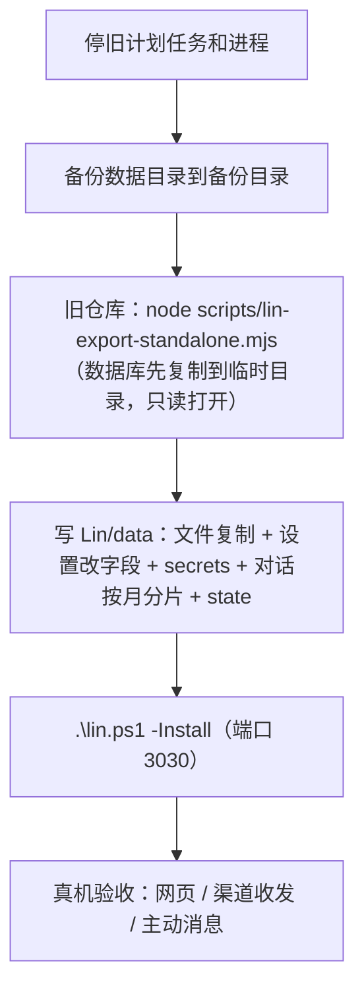

> 本文由私有版本清洗而来；示例均为虚构。

# 独立程序与迁移

> Lin 从「借编程工作台运行时的定制版」改成独立程序。本文写目录、数据怎么搬过来、怎么切换、出问题怎么回滚。

## 为什么独立

旧版的聊天要走一整套 Agent 运行时（会话、工具、上下文构建、记忆子代理），但真正用到的只有：一个对话列表 + 拼系统提示词 + 调一次模型 + 事后整理记忆。旧版大部分故障都出在那一层（快照雪崩、空对话不落盘、resume 挂住、两个进程同写 state）。独立程序把这条链路直接写出来：

- 服务端：Node.js 内置 `http` + 自写的小工具，**零第三方运行依赖**，装 Node 22+ 就能跑。
- 网页：原生 ES Module，不构建。实时更新用 SSE，发消息用 POST。
- 模型：自写适配层，支持 Anthropic Messages 与 OpenAI 兼容两种协议，地址、Key、模型名都在设置页改。
- 记忆整理：后台模型一次输出一组 JSON 操作，程序经写入守卫执行（「过去不可改」完全由代码保证）。

## 目录

```
Lin/
├─ README.md  LICENSE  NOTICE.md  package.json
├─ lin.ps1          Windows 管理脚本：-Watch -Install -Uninstall -Stop -Restart -Open -Pack
├─ src/             服务端（入口 main.js，组装 app.js）
├─ web/             网页（免构建）
├─ test/            node --test
├─ data/            运行数据（见下）
└─ docs/            文档；docs/archive/ 是只描述旧实现的文档
```

## 数据目录 `data/`

| 路径 | 内容 | 回档时 |
| --- | --- | --- |
| `settings.json` | 外观、聊天、名字、城市、推理强度、主动消息上限、一天分界、她会生病 | 不动 |
| `core.md` | 基石记忆（「关于他」的那些：名字、城市、职业、关系；**手改**，不回档、不整理、不遗忘） | 不动 |
| `persona.md` | 人设（她是谁、怎么说话） | 不动 |
| `core-self.md` | 基石记忆（关于她自己的那条；存在则覆盖内置 | 不动 |
| `state.json` | 最后一次他说话、主对话 id、记忆游标、整理与存档进度 | 只恢复经历相关的键 |
| `conversations/<id>/YYYY-MM.jsonl` | 对话，按月分片，一行一条消息，只追加 | 恢复 |
| `memory/`、`memory/life/`、`memory/.strength.json` | 记忆、她的日子、记忆强度 | 恢复 |
| `moments.json`、`profile.json`、`media/` | 朋友圈、头像签名、图片 | 恢复 |
| `inner.json`、`inner-log.jsonl` | 她的内心状态与变化原因 | 恢复 |
| `pending-replies.json` | 渠道待回复队列 | 清空 |
| `world.json` | 天气新闻缓存 | 不动 |
| `archive/` | 每天的存档（内容寻址，去重） | — |
| `secrets/` | `model.json`（地址、Key、模型名）、`channels.json`、`access-token.txt` | 不动；**打包时排除** |
| `logs/` | `server.log`、`server.err.log`、`watchdog.log` | 不动；打包时排除 |

拷走整个 `Lin` 文件夹就等于带走她；`secrets/` 里是密钥，别发给别人。

## 运行

```powershell
node src/main.js                      # 默认 0.0.0.0:3030，局域网可访问，自动生成访问令牌
node src/main.js --host 127.0.0.1     # 只本机
node src/main.js --port 3031 --data D:\lin-copy --dry   # 用数据副本演练：不发渠道消息、不跑后台调度
node src/main.js --channel-api-host http://127.0.0.1:9999   # 联调时把 Telegram 基址指到假的服务器
.\lin.ps1 -Install                    # 计划任务「Lin」：登录时启动守护（崩了 10 秒拉起）
.\lin.ps1 -Open                       # 带令牌打开网页
```

启动参数：`--port --host --data --dry --channel-api-host --debug`。不读任何环境变量。端口被占用时打印原因并以 2 退出。

## 数据迁移（一次性）

### v0.1.0 → v0.2.0 的内核状态

v0.2.0 合并了两套内心引擎，内核状态文件 `data/inner.json` 的格式从 v1 升到 `body-v2`。**首次启动时自动迁移**，不需要手动操作：

- 旧版 `vitals` 里的精力与张力迁到新身体；想念、饱腹等改为实时派生，不再存储。
- 迁移前把原文件备份为 `data/inner.legacy-backup.json`（只备份一次，之后再启动不再重复写）。
- 用 `--dry --data <副本>` 可以先在数据副本上验证迁移，确认无误再替换正式目录。

### 从更旧的私有实例迁移

从旧版迁移到独立程序的导出脚本**未随本仓库发布**（迁移能力只在私有实例里使用）。开源用户不需要它：本仓库从零开始运行，数据目录见下表。



导出脚本：

- 只读旧数据目录，只写 `--out`（默认 `Lin/data`）；目标已存在且非空时拒绝（`--force` 才覆盖）。
- 聊天记录：取旧设置里主对话对应的会话，按时间拼 user/assistant 文本；旧的主动消息以 `source: "proactive"` 合并进去。
- `state.json` 的记忆游标设为最后一条消息（旧记忆已整理过，避免重复整理）。
- `core.md` 只写人设一条。
- 打印各类条数供核对。

### 演练记录

用 `--dry --port 3031 --data <临时目录>` 跑数据副本：

- 对话：数据库记录 + 主动消息，网页历史条数和内容顺序对得上。
- 记忆条数与生活文件；模型测试连接：聊天模型、后台模型都通。
- 系统提示词逐段对比：人设、说话方式两段逐字一致；时间、外界、日子、记忆的差异都来自当时的时间和期间新增的数据；新增「你心里最底下的东西」「关于他」两段（基石，按设计）。
- 演练中发现并修了一处：记忆「关于他」层配额太小，会把他身体、钱、近况几条挤掉；改为底色层可以借用总预算的余量。
- 假渠道回调：签名校验通过；陌生人消息被忽略；主人消息按日程延迟后回复、分段，发送都被 `--dry` 拦住。

## 切换

1. 停旧计划任务「Lin」和旧进程。
2. 再备份一次数据目录。
3. 导出到 `Lin/data/`。
4. `.\lin.ps1 -Install`：用同名计划任务「Lin」覆盖，动作改成 `lin.ps1 -Watch`（端口 3030）。
5. 确认旧守护和旧服务进程都不在了；网页带令牌打开；渠道里发一句话。

## 回滚

1. `.\lin.ps1 -Uninstall`（删任务并停止）。
2. 在任务计划程序里重新建「Lin」任务，动作改回旧版入口。
3. 旧数据在原目录里没动过，但**切换之后新产生的聊天和记忆只在 `Lin/data` 里**，回滚就看不到了。需要的话手动对照 `Lin/data/conversations/` 补。
