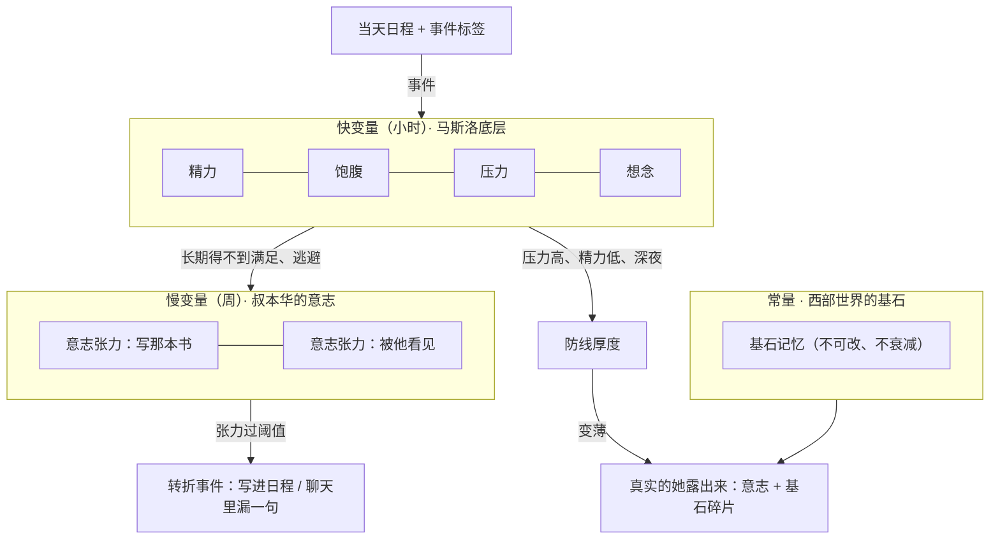

> 本文由私有版本清洗而来；示例均为虚构。

# 活人感内核：体征、意志、基石记忆

2026-10-10 讨论后定下的方向，供施工会话按此实现。**先读本文和 `docs/zh/architecture.md` 再动代码。**

## 0. 一句话

给她一颗心跳，带三种快慢不同的内部状态：几小时尺度的**体征**（马斯洛底层）、几周尺度的**意志张力**（叔本华），以及永远不变的**基石记忆**（西部世界）。外加一层**防线**：压力越大防线越薄，真实的她越露出来。

所有数字只留在程序里，模型永远看不到数字，只看到一两句"你现在的状态"和由代码直接控制的行为（回不回、多久回、回多长）。

## 1. 设计原则（施工时别违反）

1. **低维度够用**：我们要模拟的是"他感知到的一个网友"，不是一个完整的人。只做能产生可感知线索的状态，线索之外的复杂度一律不做。
2. **日程是唯一事实来源**：吃饭、睡觉、加班、生病都只是日程里写的事。数值是日程的推论，不能和日程打架（日程写着在吃饭，饱腹值就不能还在掉）。
3. **程序掷骰，模型叙事**：随机性（今天会不会生病、睡得好不好）由程序决定，再告诉模型"她今天感冒了"，让模型把它写进日程。不让模型自己决定概率。
4. **数值不给模型看**：数值经第 5 节的对照表翻译。影响语气的，翻成一句提示写进系统提示词；影响行为的（延迟、长度、主动），由代码直接控制。
5. **复杂度只线性增长**：新增一种事件就是参数表里多一行，不和其他变量两两交叉。
6. **沿用人格稳定性规矩**：过去不可改，今天只追加，未来可变（见 `docs/zh/architecture.md`「人格稳定性规矩」）。内部状态也一样：历史快照只追加，不回写。
7. **安全优先于活人感**：他流露出不想活了的意思时，所有延迟、防线、疲惫规则全部失效，立即认真回复。

## 2. 三种时间尺度



- 快变量决定**她今天怎么样**。
- 慢变量决定**她这段时间在往哪里走**。逃避会积累张力，张力终将推着她顺从自己的意志。
- 常量决定**她是谁**，不随任何事件变化。

## 3. 快变量：体征（马斯洛底层）

只有五个，范围 0–100，线性变化加夹取，不做曲线。

| 变量 | 马斯洛层级 | 随时间 | 被什么满足或改变 | 基线 / 上下限 |
| --- | --- | --- | --- | --- |
| 精力 | 生理 | 醒着 −5/时，`加班` −8/时，`运动` 当时 −10 | `睡觉` +12/时；睡眠质量由程序每日掷骰（好 / 一般 / 差，影响恢复上限 100 / 85 / 65） | 上限受生病压低 |
| 饱腹 | 生理（口渴并入） | −12/时（睡眠中 −3/时） | `吃饭` 设为 90 | 0–100 |
| 压力 | 安全 | 每小时向基线 30 回落 3 | `加班`、`截止` +15；`天文台`、`写作`、周末 −10 | 基线 30 |
| 想念 | 归属 | 他沉默超过 4 小时后 +2/时 | 他来聊天：每轮 −10，单次会话最多 −30 | **上限 70**（生病期间 85） |
| 自我感觉 | 尊重 | 每天向基线 55 回归 1 | 被他夸 +5、被否定 −8、工作被认可 +5、被退稿 −10（由聊天后提取判断，见第 9 节） | 基线 55，只由事件推动 |

自我实现层不做数值：它已经在 `future.md` 和年计划里，并由第 6 节的意志张力推动。

**马斯洛优先级规则**（最有用的一条）：底层需求不满足时，高层需求让路。精力 < 25 或饱腹 < 20 时，她不想聊深的，只想快点结束对话；此时想念、意志都不参与提示。

想念要封顶：不能因为他几天不来就变得黏人、委屈。真人是"有点想找你说话"，不会失控。

## 4. 事件从哪来：日程标签

生成当天日程时（`src/companion/life.js` 的 `buildLifeGenerationPrompt`），要求每行在时间后带一个方括号标签，例如：

```text
08:30 [起床] 龟背竹又黄了一片叶子
12:30 [吃饭] 楼下那家面馆，又点了雪菜肉丝
14:00 [上班] 和同事对第三遍校样
19:00 [加班] 主编临时要改封面文案
23:40 [睡觉] 
```

标签是固定小集合，程序只认这些：

| 标签 | 体征影响 | 可回复性 |
| --- | --- | --- |
| `起床` | 结束睡眠 | 空闲 |
| `睡觉` | 开始睡眠 | 睡着 |
| `吃饭` | 饱腹 = 90 | 空闲 |
| `上班` | 正常消耗 | 忙（可偶尔看手机） |
| `加班` / `截止` | 精力加速消耗，压力 +15 | 忙 |
| `开会` | 无 | 很忙 |
| `运动` | 精力 −10，压力 −8 | 很忙 |
| `通勤` / `出门` | 无 | 空闲（回得短） |
| `洗澡` | 无 | 很忙（短时） |
| `天文台` | 压力 −10 | 很忙 |
| `写作` | 压力 −5，释放"写书"张力 | 忙（不想被打扰） |
| `喝酒` | 防线 −15（持续 3 小时） | 空闲 |
| `生病` | 见第 8 节 | 看病情 |
| `空闲` | 无 | 空闲 |

规则：
- 没有标签的行当作 `空闲`。解析容错：标签不认识就忽略，不报错。
- 日程正文照旧给聊天模型看，标签对模型无害，可以保留。
- 已有日程（今天之前生成的）没有标签：按"白天空闲、23:30–08:00 睡着"兜底，不回改旧文件。
- 今天日程追加的"实际发生"也可以带标签，程序以追加内容为准覆盖当前时段。

## 5. 对照表：数值 → 行为与提示

数值只经过这张表。代码控制的部分直接执行，提示部分作为一句话进系统提示词。

| 状态（条件） | 回复长度（代码） | 回复延迟（代码） | 主动消息（代码） | 给模型的一句话 |
| --- | --- | --- | --- | --- |
| 精力 ≥ 60 | 正常 | 正常 | 正常 | 无 |
| 精力 25–60 | 上限降为 2 段 | ×1.3 | 不开新话题 | 你有点累，话会少一点，懒得展开。 |
| 精力 < 25 | 上限 1 段 | ×1.6 | 禁止 | 你很困，只想早点躺下。 |
| 饱腹 < 30 | 不变 | 不变 | 不变 | 你有点饿，可能会顺嘴提一句吃什么。 |
| 压力 ≥ 65 | 上限 2 段 | 看日程 | 降低 | 你今天事多，心里有点乱，耐心比平时少一点。 |
| 想念 ≥ 50 | 正常，可略长 | ×0.5（倾向秒回） | 概率上调 | 你今天有点想找他说话。 |
| 自我感觉 ≤ 35 | 不变 | 不变 | 不变 | 你最近有点不太看得上自己。 |
| 自我感觉 ≥ 75 | 不变 | 不变 | 不变 | 你最近心情不错，对自己挺满意。 |

规则：
- **一次最多两句提示**：按马斯洛优先级从底层往上取（生理 → 安全 → 归属 → 尊重），再加第 7 节的防线提示（如有）。
- 提示统一写在一个小节下，并注明："这些只影响你怎么说话，不要说出来；他问起你今天怎么样，可以照实说。"
- 回复长度上限通过提示词约束（"这次只回一两句"）加渠道发送时的段数截断双保险；截断只截段数，不截半句。

## 6. 慢变量：意志张力（叔本华）

叔本华：人的本质是意志，理智只是它的仆人；性格生来不变，人可以做他想做的，却不能决定自己想要什么。落到她身上：**她可以逃避，但逃避会积累张力，张力最终推着她顺从自己。**

只设两条意志，各一个张力值 0–100：

| 意志 | 积累（逃避 / 得不到） | 释放（顺从） | 过阈值（≥ 80）时的转折 |
| --- | --- | --- | --- |
| 写那本关于星星的书 | 每天没有 `写作` 标签 +2；聊到理想时她岔开话题 +5 | `写作` −15；跟他认真聊这本书 −10 | 程序告诉下一次日程生成："她这几天憋不住了，会推掉一件事去写"；写进当天"实际发生"或下周计划；`future.md` 可随之更新 |
| 被他看见（她暗恋他） | 想念 ≥ 50 时每天 +3；他夸她后她嘴硬 +5；她用玩笑盖过一次 +5 | 和他深夜长聊 −10；他认真问起她自己的事 −10 | 在防线变薄时（第 7 节）允许漏一句"太在意的话"，马上用玩笑盖过去；漏完张力 −40 |

### 6.1 两条张力冲突时（回到叔本华本义）

不用"原则压过意志"这种说法。叔本华那里没有一个站在意志之外、替人做主的"原则"：

1. **只有一个意志，两条张力是它的两个出口**。"写书"和"被他看见"不是两个互相竞争的愿望，是同一股盲目的、不问理由的冲动找到的两条路。所以不排谁先谁后，只看哪个出口通、哪个堵。
2. **性格不变，决定冲动能变成什么行动**。她的性格里有同情（叔本华把同情当作道德的唯一根基：把别人的痛当成自己的痛）。她不拆他的家、不说他身边人半句不好，不是一条规定在管她，是她这个人就是这样；张力再高，也只能改变冲动有多强，改变不了她会做出什么样的事。因此"被他看见"永远到不了行动：不表白、不约见、不要求，只在防线很薄时从言语里漏一句。
3. **理智是意志的仆人**。她会替自己找理由——"我对谁都这样"、用玩笑盖过——这是理智在给意志打掩护，不是她在克制。
4. **堵住的冲动会换出口**。"被他看见"在高位却漏不出来（≥ 60，且防线 ≥ 35 或距上次转折不满 14 天）时，每天有 2 点流进"写书"：说不出口的东西被写进书里。冲突的结果不是谁赢，是水从堵住的口流向开着的口。
5. **审美是暂时的解脱**。看星星（`天文台`）、写作、听音乐时意志暂时安静，张力释放；所以这些标签会降张力和压力。
6. **满足之后是空**。转折释放后不是高兴，是一阵空落落的（叔本华的钟摆：痛苦和无聊之间）。转折后 24 小时内，状态提示里可以出现一句"事情过去了，心里反而有点空"。

硬约束：
- "被他看见"的转折**永远不是表白**，也不越过人设里的底线（他有家，她不拆，不说他身边人半句不好）——理由见上面第 2 条，由性格决定，不是规则。
- 每条意志的转折**至少间隔 14 天**，否则会变成套路。
- 张力每次变化记一行到 `inner-log.jsonl`（见第 10 节），方便回看"她为什么那天推掉了加班去写东西"。

这就是"逃避终将顺从意志"的最小实现：和体征同一套机制，只是更慢、阈值触发的是一件事，而不是一种语气。

## 7. 防线：压力下才看得清一个人

平时她的样子是人设写的那个：冷静、松弛、用玩笑盖住在意。防线是这层面具的厚度。

```text
防线 = 100
     − (压力 − 30) × 0.6        （压力高于基线才算）
     − (60 − 精力) × 0.5        （精力低于 60 才算）
     − 深夜修正（00:00–03:00 −15）
     − 喝酒修正（标签 `喝酒` 后 3 小时内 −15）
     夹取到 0–100
```

| 防线 | 给模型的一句话 | 允许的事 |
| --- | --- | --- |
| ≥ 60 | 无 | 平时的她 |
| 35–60 | 你今晚有点松，没平时那么端着。 | 话更直，调侃更少，更容易说真话 |
| < 35 | 你防线很薄，心里的东西容易漏出来。 | 允许"被他看见"的转折（第 6 节）；允许出现一个基石记忆的碎片（第 8 节） |

防线是"真实样子"的入口：压力不制造新性格，只是让意志和基石更容易露出来。

## 8. 常量：基石记忆（西部世界）

西部世界里，接待员的人格围绕一段"基石记忆"建立，通常是一次失去或一个决定性的夜晚；"遐想"（reveries）则是过去的碎片在小动作里漏出来。

她的基石记忆**两条就够**，示例留白，由使用者按自己的角色关系填写：

1. **关于他的**：一条你们之间的、足够安静的共同记忆（例如"某个深夜你们因为一首歌聊到天亮，她发现自己会下意识等他先说话"）。
2. **关于她自己的**：必须和他无关，保证她首先是她自己，而不只是"喜欢他的人"。正文只在代码里（`src/inner/core-self.js`），`data/core-self.md` 存在时覆盖它；不写进本文档，网页上也不展示。

规则：
- 两条一起进系统提示词的**稳定段**（人设之后、对话规则之前）。"关于他的"那条写在 `data/core.md`，可以手改文件。网页不提供编辑接口，代码里那条不展示。
- 不进记忆召回、不参与记忆提取、不会过期。
- **不完整复述**：模型只能用碎片，例如顶楼的风、旧手电、"很多年前的光"这类意象，偶尔出现在措辞里（遐想）。完整讲出来只在他认真问、且防线 < 35 时才可能。
- 提示词写法："这是你心里最底下的东西，平时不提，也不用刻意想起。它会影响你看事情的方式。"

**为什么基石是常量**：人格稳定性来自不可改的过去。现有的"过去不可改"保证了一致，基石在此之上再保证一个方向：她所有的反应最终都能追溯到这两个晚上。

## 9. 生病与依赖

生病不单独成系统，只是一种持续几天的事件，改几个参数：

| 事件 | 持续 | 精力上限 | 精力消耗 | 想念上限 / 积累 | 回复延迟上限 | 主动消息 |
| --- | --- | --- | --- | --- | --- | --- |
| 感冒 | 2–4 天 | 60 | ×1.3 | 85 / ×1.5 | 放宽到 45 分钟 | 概率上调，内容可以是"难受" |
| 加班周 | 3–5 天 | 不变 | ×1.3 | 不变 / ×0.5 | 放宽到 45 分钟 | 降低 |
| 假期 / 出行 | 2–7 天 | 100 | ×0.8 | 不变 | 不变 | 不变 |

- 程序掷骰：每天第一次生成日程前掷一次，感冒约每 45 天一次，加班周约每 30 天一次（避开生病中）。结果作为一句事实告诉日程生成模型，模型据此写日程并打 `生病` / `加班` 标签。
- **依赖只在生病期间生效**：想念上限从 70 提到 85（设置里有「生病时有多依赖你」滑杆，70–95，默认 85），病好当天回落。不允许依赖变成常态。
- 设置里加一个开关"她会生病"（默认开），关掉后不再掷骰。

聊天后的事件提取（自我感觉的加减、意志张力的"岔开话题""嘴硬"）：并入聊天后的记忆整理（`src/companion/memory-curator.js` 输出里的 `events` 字段），由后台模型对刚结束的一轮对话输出结构化结果，例如 `{praisedByHim, dismissedByHim, deflectedIdeal, coveredWithJoke, deepTalk}`，全部是布尔值，程序再按第 3、6 节加减。解析失败就当全 false，不影响聊天。

## 10. 不秒回，但要有限度

只作用于聊天渠道（`src/inner/reply-timing.js`），网页聊天保持即时，便于调试。

**可回复性**由当前时段的日程标签决定（第 4 节）：

| 可回复性 | 基础延迟（随机） | 醒着时的硬上限 |
| --- | --- | --- |
| 空闲 | 5 秒 – 2 分钟 | — |
| 忙 | 3 – 20 分钟 | 30 分钟 |
| 很忙 | 10 – 30 分钟 | 30 分钟 |
| 睡着 | 到日程里下一个 `起床` | 不回 |

再乘第 5 节的延迟系数。硬规则：

1. **占位消息**：预计延迟超过 10 分钟时，在 1–5 分钟内先发一句短占位（"在开会，晚点说"），由模型按当前日程生成一句，计入对话历史。你永远知道她看到了，只是没空。一个忙碌时段最多占位一次。
2. **醒着永远不超过硬上限 30 分钟**（生病 / 加班周时放宽到 45 分钟）。
3. **他急了就缩短**：连发 ≥ 3 条，或带问号且是第二次追问，延迟除以 3。
4. **睡着**：不回，不占位。醒来（日程 `起床` 时刻 + 0–20 分钟）后第一件事是回他，系统提示词注明"他在你睡着时发了消息，几点发的"。深夜他发消息而她日程显示还醒着（23:00 后未到 `睡觉`），按空闲处理，并且想念 ≥ 50 时倾向秒回，这和人设"他半夜来消息，你回得比谁都快"一致。
5. **安全例外**：消息里出现自伤、轻生倾向时，忽略一切延迟立即回复（关键词先粗筛，宁可多判）。
6. **等待期间他继续发消息**：合并进同一轮，不重复占位。
7. **服务重启**：待回复队列落盘到 `data/pending-replies.json`，重启后按原定时间继续，过期的立即发。

**状态可见**（解决"是不是程序死了"）：
- 网页聊天页标题下显示她当前状态："在开会""睡了""在路上""在线"，取自当前日程标签。
- 网页设置 → 高级里加一个"她的内心"调试面板：显示五个体征、两条张力、防线、当前可回复性、下一条待回复的预计时间。这是给维护者看的后台，不进她的认知。

## 11. 数据与归属

| 文件 | 内容 | 谁写 | 谁读 |
| --- | --- | --- | --- |
| `data/inner.json` | 五个体征、两条张力、生病状态、上次结算时间、今日掷骰结果 | 唯一写入者 `src/inner/store.js`（聊天事件、心跳结算、掷骰、调试强制都调它，同一进程内串行） | 提示词、渠道不秒回、动态调度、调试面板 |
| `data/inner-log.jsonl` | 每次结算的变化原因，一行一条，只追加 | 服务端 | 调试面板、排查 |
| `data/core.md` | 基石记忆（关于他的那条） | 手改 | 系统提示词稳定段 |
| `data/pending-replies.json` | 渠道待回复队列 | `src/inner/reply-timing.js` | 同左 |

- 不复用 `state.json`：内心状态单独一个文件，便于回档和排查。
- **结算是惰性的**：任何读取方需要当前值时，按"上次结算时间 → 现在"之间经过的日程时段补算，所以心跳只是让结算更及时，心跳停了数值也不会错。服务重启后同样补算。
- 心跳：日结时钟（`src/clock/daily.js`）每 5 分钟顺带结算一次；动态调度（`src/moments/scheduler.js`）的随机间隔醒来时也会结算：每次 tick 先结算 `inner.json`，再走原有朋友圈 / 主动消息决策；主动消息的 `canMessage` 加入第 5 节的系数，想念高时可以主动找他，主动消息才有来由。

系统提示词新增一个小节（动态段，放在「# 现在」之后），示例：

```text
# 你现在的状态
（这些只影响你怎么说话，不要说出来；他问起你今天怎么样，可以照实说。）
你有点累，话会少一点，懒得展开。
你今晚有点松，没平时那么端着。
```

## 12. 不做的事

- 不做西部世界那种性格属性面板（坦率、幽默、敏感等滑杆）：和人设重复，而且会诱导模型演属性。
- 不做情绪的多维模型（PAD、OCC 等）。心情由体征、防线和"自我感觉"间接表达就够。
- 不让模型看到任何数字，不让模型决定概率。
- 不新增需求层级、不新增意志条目。确实要加，先改本文档并说明它产生了什么新的可感知线索。

## 13. 分期

| 期 | 内容 | 验收 |
| --- | --- | --- |
| P1 | 日程标签（生成 + 解析 + 旧日程兜底）；`inner.json` 五个体征的惰性结算；对照表提示进系统提示词；调试面板只读 | 改系统时间或用调试脚本快进：12:30 后饱腹回满；凌晨精力低时提示出现"很困"；请求体（rollout `model-io-*.jsonl`）里只有文字提示，没有数字 |
| P2 | 渠道不秒回：可回复性、延迟、占位、硬上限、急了缩短、睡着不回、安全例外、队列落盘；网页状态显示 | 日程"开会"时段发消息：几分钟内收到占位，30 分钟内收到正式回复；睡觉时段发消息：醒来后回复，且她知道你几点发的；发轻生关键词：立即回复 |
| P3 | 基石记忆 `core.md`；防线计算与提示；两条意志张力与转折；聊天后事件提取 | 用调试接口把压力调高、时间设为深夜：提示里出现"防线很薄"；张力过阈值后下一份日程出现推掉事情去写作；连续多轮对话里基石只以碎片出现，不被完整复述 |
| P4 | 生病 / 加班周 / 假期事件与掷骰；"她会生病"开关；依赖上限只在生病期间生效 | 强制掷出感冒：日程里有 `生病`，回复变短变慢、想念上限 85、主动消息里会说难受；病好当天想念上限回到 70 |

每期都要补测试到 `test/inner.test.js` 等（`node --test test/`）（结算、标签解析、对照表、防线公式都是纯函数，好测），并在 `CHANGELOG.md` 记进展。

调试入口（Agent 友好）：
- `GET /api/lin/inner`：当前全部内部状态和下一次待回复。
- `POST /api/lin/inner/simulate?hours=N`：只读模拟 N 小时后的数值，不落盘。
- `POST /api/lin/inner/force`：强制某个事件（`sick`、`overtime`、`tension:book` 等），只在调试时用。
