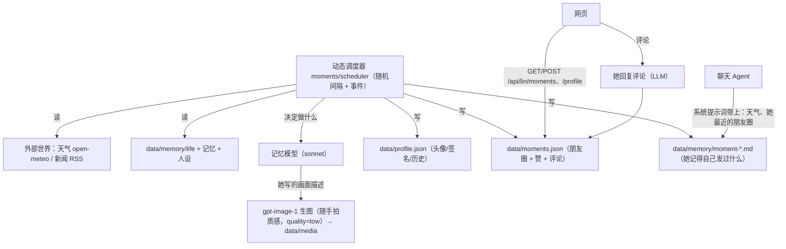

> 本文由私有版本清洗而来；示例均为虚构。

# 她的动态：头像、签名、朋友圈

需求整理：

- 头像、个性签名由她自己换。她会去生成符合她人设和当时心情的图。
- 她会发朋友圈，配文加上生成的图。
- 触发方式：随机时间，或者由事件触发（聊天、天气、新闻大事、她日程里的事）。**不要整点定时那种规律感。**
- 她定居上海，偶尔去国内外旅行；城市可以在设置里改。
- 朋友圈可以点赞、评论，她会回复。
- 界面上不能出现原编程工作台的任何字样或 logo。
- 「她」的设置不单独占一个底部页签，全部放进设置里（底部只剩「消息 / 朋友圈 / 我」）。

## 状态所有者

由常驻服务里的 `src/moments/` 统一负责（`scheduler.js` 调度、`decide.js` 决定、`execute.js` 执行、`interact.js` 点赞评论）。聊天链路不参与这里的逻辑。

- `profile.json`：`{ avatar?: {file, query, at}, signature?: {text, at}, history: [...] }`。手动在设置里改的签名或头像颜色只作为默认值，她换过之后以 profile 为准。
- `moments.json`：`{ posts: [{ id, at, text, images: [file], location?, trigger, likes: ["me"], comments: [{ id, from: "me"|"her", text, at, replyTo? }] }] }`。
- `world.json`：天气和新闻的缓存（30 分钟有效）。
- `media/`：下载下来的图片，文件名用内容 hash；只通过 `/api/lin/media/:file` 读。

## 触发规则

- 调度器每 7–23 分钟醒一次，间隔随机。醒来先看有没有事件，再按概率决定动不动。
- 事件：
  - 天气变化：天气代码大类变了（晴→雨），或者昼夜温差很大。
  - 新闻：出现新的头条，且她可能在意（交给模型判断，大多数时候不在意）。
  - 聊天：一轮聊完之后，聊天内容情绪浓度高，由模型决定是否发动态。
  - 日程：今天日程里接近当前时间的段落，比如天文台讲课、出门。
- 每天上限：朋友圈不超过 3 条，头像每 3 天最多换 1 次，签名每天最多换 1 次。
- 安静时段：凌晨 2:00–7:00 不发，除非日程写着她那时醒着。
- 决策交给模型，要求它输出 JSON：`{action: "none"|"post"|"avatar"|"signature"|"message", text?, imagePrompt?, imageCaption?, reason}`。`imagePrompt` 是她自己写的画面描述（拍的是什么、在哪、光线、角度、这张照片该有的随意感）；程序按用途补上手机随手拍的质感（「iPhone 原厂相机 无 PS 痕迹 偶尔手抖 仿佛随手拍摄」这类，夜景换夜拍）或头像方图的要求，再调 gpt-image-1 生成。不再联网搜图（公开图搜结果常是防盗链占位图，头像看起来换了其实没换）。
- 图片生成失败时：朋友圈改发纯文字；换头像则放弃这次。

## 朋友圈互动

- 点赞是本地操作，立即生效。她会在 1–8 分钟后看到（异步，随机延迟）。
- 评论之后，她会在 0.5–6 分钟（随机）后回复，回复内容由模型生成。用户评论和她的回复都写进记忆（event 类）。

## 聊天里能感知

系统提示词的「现在」段新增两项：

- 今天上海的天气（一句话）
- 她最近 3 条朋友圈的内容和你们的互动

## 去工作台化（界面）

- `index.html`：启动画面不使用原工作台的 logo，换成 Lin 的启动样式；`favicon` 换成 Lin 的图标。
- 设置 → 高级：没有「打开原界面」的入口。
- 所有 `document.title` 都改成 `Lin`。
- 代码里的变量名、localStorage key 不算界面，不改。

## 验收

1. 底部页签是「消息 / 朋友圈 / 我」；她的所有设置都在「我 → 设置」里。
2. 手动触发 `POST /api/lin/moments/tick?force=post` 后，朋友圈出现一条带动态的图。
3. 评论一条，几分钟内她会回复。
4. 头像能换成生成的图，聊天页、列表页、朋友圈里都同步。
5. 界面任何地方都看不到原工作台的名字。
